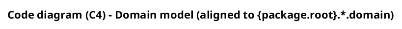
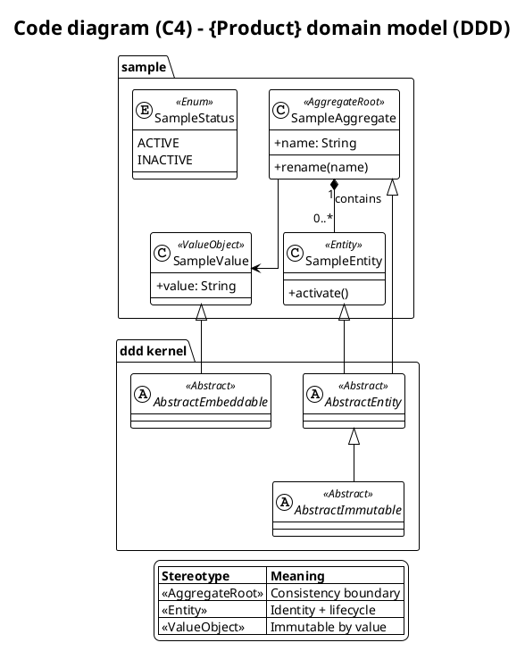
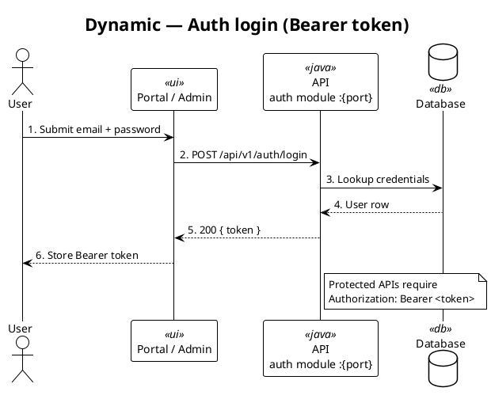

# C4 model (PlantUML) — standards & style

Canonical layout and style for repo living C4 diagrams (reference:
partner/iam — **white body, black text, black borders**).

Path when present: `docs/developer/c4-model/` (or `docs/c4-model/`).  
**Source of truth:** `.puml`. PNG is optional; regenerate when PlantUML is available.

Official C4: [c4model.com](https://c4model.com/).  
Library: [C4-PlantUML](https://github.com/plantuml-stdlib/C4-PlantUML).

## Visual tracks (do not mix includes)

| Track | Files | Style |
|-------|-------|-------|
| **Structural C4** | C1–C3, Deployment | [`style.puml`](./style.puml) tokens **inlined** after C4 include (white / black) |
| **Domain + Dynamics** | Code domain model, `C4-Dynamic-*` | `!theme plain` + black/white `skinparam` (no colored zinc headers) |

Rules:

- Do **not** use `!theme C4_blue_new`, bare `!NEW_C4_STYLE=1`, or zinc/colored stereotype palettes.
- Do **not** `!include style.puml` in structural diagrams (PlantUML preview temp dirs break includes). **Inline** the same statements after the C4 include.
- Do **not** apply C4-PlantUML `Rel` / container dynamic macros to Dynamics — use PlantUML **sequence**.
- One visual language: white fill `#FFFFFF`, ink `#000000`, no shadow.

### When to open which track

- Boundaries / deploy topology → Structural C4 (inlined `style.puml`).
- Ubiquitous language / aggregates → Code domain model (plain B&W class).
- Planned domain deltas (before merge to as-built) → `C4-Code-Domain-Model-Plan.puml` (optional).
- Runtime request paths (login, proxy, WS subscribe, …) → `C4-Dynamic-*` (plain B&W sequence).

## Required file set

| File | Level | Owns |
|------|-------|------|
| `C1-Context.puml` | Context | People, system boundary, external systems |
| `C2-Container.puml` | Container | Apps, APIs, data stores, major tech + ports |
| `C3-Component.puml` | Component | **One** diagram: backend modules **and** UI apps (do **not** split Backend/Frontend siblings) |
| `C4-Code-Domain-Model.puml` | Code | DDD class model (as-built; aggregates / entities / VOs + public domain behavior) |
| `C4-Code-Domain-Model-Plan.puml` | Code (plan) | Optional delta vs as-built; mark adds/removes before merge |
| `C4-Deployment.puml` | Deployment | **One** view: local/dev + production notes (do **not** keep a separate Production-only file) |
| `C4-Dynamic-{Flow}.puml` | Dynamic | One sequence diagram per critical runtime flow (as many as needed) |
| `style.puml` | Shared | Structural style **copy** — diagrams inline these lines; see [style.puml](./style.puml) |
| `README.md` | Index | File table, stack/ports, render command |

Keep Component and Deployment **unsplit** unless the repo already has an approved exception.

If a repo still has `style-zinc.puml` / `style-domain.puml` or `C4_blue_new` structural themes, **replace** with this white/black style in the same change (`style.puml` + rewrite headers).

## Style — Structural C4 (C1–C3 / Deployment)

1. Order **exactly**:

```plantuml
@startuml
!ROUNDED_STYLE=1
!include https://raw.githubusercontent.com/plantuml-stdlib/C4-PlantUML/master/C4_Context.puml
' 样式内联自 style.puml（勿改为 !include）
UpdateElementStyle("person", "#FFFFFF", "#000000", "#000000")
UpdateElementStyle("external_person", "#FFFFFF", "#000000", "#000000")
UpdateElementStyle("system", "#FFFFFF", "#000000", "#000000")
UpdateElementStyle("external_system", "#FFFFFF", "#000000", "#000000")
UpdateElementStyle("container", "#FFFFFF", "#000000", "#000000")
UpdateElementStyle("external_container", "#FFFFFF", "#000000", "#000000")
UpdateElementStyle("component", "#FFFFFF", "#000000", "#000000")
UpdateElementStyle("external_component", "#FFFFFF", "#000000", "#000000")
UpdateElementStyle("node", "#FFFFFF", "#000000", "#000000")
UpdateBoundaryStyle("", $bgColor="#FFFFFF", $fontColor="#000000", $borderColor="#000000")
UpdateRelStyle("#000000", "#000000")
skinparam backgroundColor #FFFFFF
skinparam shadowing false

LAYOUT_WITH_LEGEND()
title [C4 Level 1] {Product} - 系统上下文
```

   Same pattern for `C4_Container.puml` / `C4_Component.puml` / `C4_Deployment.puml`
   (titles: `[C4 Level 2]` / `[C4 Level 3]` / `[C4 Deployment]`).
2. Prefer concrete `Rel(from, to, "label", "protocol")` (`HTTPS`, `HTTP :port`, `JDBC`, `REST /api/v1`, …).
3. Group with `System_Boundary` / `Container_Boundary` / `Deployment_Node`.
4. Ids in `snake_case`; human names in Title Case; hint tech + path/port when useful.
5. End with `SHOW_LEGEND()`.

Canonical shared copy: [style.puml](./style.puml) → repo `docs/.../c4-model/style.puml`.

## Style — Domain + Dynamics (plain B&W)

### Rendering model

- Canvas `#FFFFFF`; class / participant body white; border and font `#000000`; **no shadow**.
- Domain: `!theme plain` + class `skinparam` (do **not** tint stereotype headers).
- Dynamics: `!theme plain` + sequence; optional role stereotypes (`<<ui>>`, `<<java>>`, `<<db>>`) without colored zinc borders.
- `skinparam classAttributeIconSize 0` so UML `+` renders as text.
- Prefer `linetype ortho` on class diagrams.

### Code / domain model

Must be a DDD class model (kernel + types + **public domain behavior** on aggregates/entities). Code: [ddd-rich-model](./ddd-rich-model.md).

Required header:



Legend (stereotype meanings; ink stays black/gray text — **not** colored class headers):

```plantuml
legend right
  |= Stereotype |= Meaning |
  | <<AggregateRoot>> | Consistency boundary |
  | <<Entity>> | Identity + lifecycle |
  | <<ValueObject>> | Immutable by value |
  | <<DomainService>> | Stateless domain / port |
  | <<Repository>> | Outbound port in domain/ |
endlegend
```

**UML member notation** (required on aggregates/entities):

```plantuml
class SampleAggregate <<AggregateRoot>> {
  +id: SampleId
  +name: String
  --
  +{static} create(name)
  +rename(name)
}
```

- Fields: `+fieldName: Type`
- Methods: `+methodName(params)` (no return type unless clarifying)
- Static factories: `+{static} create(...)`
- Separator `--` between fields and methods

Hard rules:

1. Package **ddd kernel** shows `AbstractImmutable`, `AbstractEntity`, and embeddable/VO bases when the repo uses them; inheritance matches code (`<|--` / `--|>`).
2. Kernel / mapped superclasses use `<<Abstract>>` (not `<<MappedSuperclass>>` on the diagram).
3. `<<AggregateRoot>>` on consistency roots; `<<Entity>>` on child entities; `<<ValueObject>>` on VOs.
4. **`enum X <<Enum>> { … }`** — never `<<ValueObject>>` on enums.
5. One package per bounded context. `"1" *-- "0..*"` ownership; `o--` optional; `-->` / `..>` reference.
6. No controller, DTO, or infra types on the diagram.
7. Every `<<AggregateRoot>>` and `<<Entity>>` lists **public domain methods** as `+methodName(params)` — Glossary verbs, camelCase; must match code. Do **not** list trivial getters unless they encode domain language. `<<ValueObject>>` shows fields + domain behavior methods only when they carry rules (e.g. `+matchesQuery()`).

Do **not** draw only stereotypes without kernel inheritance when the codebase has a shared kernel.

Skeleton:



### Plan diagram (optional delta)

File: `C4-Code-Domain-Model-Plan.puml` — same B&W header and UML notation as as-built.

Mark changes vs `C4-Code-Domain-Model.puml` with **GitHub Primer diff foreground** (light mode):

| Meaning | Markup |
| ------- | ------ |
| Add | `<color:#1A7F37>…</color>` |
| Remove | `<color:#CF222E>…</color>` (no strikethrough) |

Legend swatches for plan deltas use `<color:#HEX>██</color>` (not `<back:#color>` — breaks VS Code preview).

Whole new types: normal styling + `note right of Type : new aggregate` (avoid wrapping entire `class { … }` blocks in `<color>` tags).

After review, merge into as-built and remove color marks.

### Dynamic diagrams (sequence)

Required header (filename = `@startuml` id = `C4-Dynamic-{Flow}`):


Then:

1. One **critical user/runtime path** per file (happy path + essential notes); not every endpoint in one mega-sequence.
2. `actor` for people; `database` for stores; `participant` for UI / API / bus / external. Role stereotypes optional (`<<ui>>`, `<<java>>`, `<<db>>`, …).
3. Participant labels: human name + module/path + port when useful; wrap with `\n`. Aliases lowercase (`ui`, `auth`, `db`).
4. Number messages when it helps clarity; returns `-->`; optional/config hops labeled `(optional)` / `(if enabled)`.
5. Short `note` for auth header, payload, or docs pointer — no essays.
6. Prefer Glossary Preferred Terms for domain names.

Skeleton:



## Render

```bash
cd docs/developer/c4-model && mkdir -p png && plantuml -tpng -o png *.puml
# or: plantuml -tpng -o png C4-Code-Domain-Model.puml C4-Dynamic-*.puml
```

Commit `.puml` (+ README + `style.puml` + optional `png/`). Online: [PlantUML server](https://www.plantuml.com/plantuml/uml/).

## When to edit (cheat sheet)

| File | Update when |
|------|-------------|
| `C1-Context.puml` | New actor/external system, or system purpose change |
| `C2-Container.puml` | New app/API container, subdomain, major store, port change |
| `C3-Component.puml` | New feature module, UI app surface, or cross-app wiring |
| `C4-Code-Domain-Model.puml` | New/changed aggregate, entity, VO, enum, domain association, or public domain method |
| `C4-Code-Domain-Model-Plan.puml` | Planned domain delta before as-built merge |
| `C4-Deployment.puml` | Local or prod topology, ports, hosting, runtime nodes |
| `C4-Dynamic-{Flow}.puml` | New or changed critical runtime path (auth, proxy, WS, payment, …) |
| `style.puml` | Shared structural white/black tokens change (then re-inline into C1–C3 / Deployment) |
| `README.md` | File table, stack/ports, or render notes change |

Living-docs trigger matrix: [living-docs](./living-docs.md).
