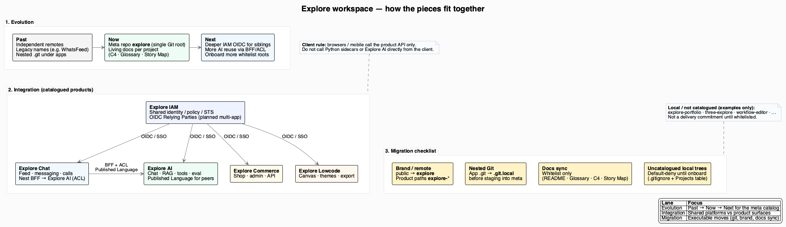
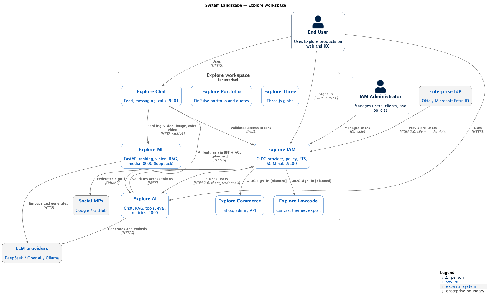
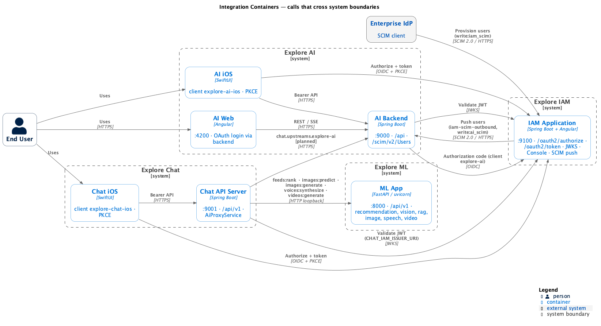

# Explore workspace docs

How catalogued Explore products **fit together** in this meta repository (`felixzhu97/explore`): timeline, connections, and how projects move into the catalog.

Per-product software architecture stays under each project’s `docs/developer/c4-model/`. This folder does not replace those C4 models.

## Workspace Map



Source: [`Workspace-Map.puml`](Workspace-Map.puml)

### How to read

| Lane | Meaning |
|------|---------|
| **Evolution** | Past → Now → Next for the catalog (remotes, living docs, shared platforms) |
| **Integration** | Shared platforms (IAM, AI) vs product surfaces (Chat, Commerce, Lowcode) |
| **Migration** | Executable moves: brand/remote, nested Git, docs whitelist, onboard |

### Catalogued products (links)

| Product | C4 | Glossary | Story Map |
|---------|----|----------|-----------|
| [Explore AI](../explore-ai/README.md) | [c4-model](../explore-ai/docs/developer/c4-model/) | [Glossary](../explore-ai/docs/Glossary.md) | [User Story Map](../explore-ai/docs/product-owner/User-Story-Map.md) |
| [Explore IAM](../explore-iam/README.md) | [c4-model](../explore-iam/docs/developer/c4-model/) | [Glossary](../explore-iam/docs/Glossary.md) | [User Story Map](../explore-iam/docs/product-owner/User-Story-Map.md) |
| [Explore Chat](../explore-chat/README.md) | [c4-model](../explore-chat/docs/developer/c4-model/) | [Glossary](../explore-chat/docs/Glossary.md) | [User Story Map](../explore-chat/docs/product-owner/User-Story-Map.md) |
| [Explore Commerce](../explore-commerce/README.md) | [c4-model](../explore-commerce/docs/developer/c4-model/) | [Glossary](../explore-commerce/docs/Glossary.md) | [User Story Map](../explore-commerce/docs/product-owner/User-Story-Map.md) |
| [Explore Lowcode](../explore-lowcode/README.md) | [c4-model](../explore-lowcode/docs/developer/c4-model/) | [Glossary](../explore-lowcode/docs/Glossary.md) | [User Story Map](../explore-lowcode/docs/product-owner/User-Story-Map.md) |
| [Explore ML](../explore-ml/README.md) | [c4-model](../explore-ml/docs/developer/c4-model/) | [Glossary](../explore-ml/docs/Glossary.md) | [User Story Map](../explore-ml/docs/product-owner/User-Story-Map.md) |
| [Explore Portfolio](../explore-portfolio/README.md) | [c4-model](../explore-portfolio/docs/developer/c4-model/) | [Glossary](../explore-portfolio/docs/Glossary.md) | [User Story Map](../explore-portfolio/docs/product-owner/User-Story-Map.md) |
| [Explore Three](../explore-three/README.md) | [c4-model](../explore-three/docs/developer/c4-model/) | [Glossary](../explore-three/docs/Glossary.md) | [User Story Map](../explore-three/docs/product-owner/User-Story-Map.md) |

Uncatalogued local trees stay default-denied until onboarded — see [sync-repo](../.cursor/skills/developers/public-docs/references/sync-repo.md).

## System Landscape

Which Explore systems talk to each other, and over what: IAM as OIDC provider and SCIM hub, Chat calling the ML app, and the planned Chat to AI BFF.



Source: [`C1-System-Landscape.puml`](C1-System-Landscape.puml)

The integration container view keeps only the containers that make cross-system calls, with protocol, port, client id, and scope on each relation.



Source: [`C2-Integration-Container.puml`](C2-Integration-Container.puml)

## Core Dynamics

The four runtime flows that cross system boundaries:

| Flow | Purpose |
| --- | --- |
| [OIDC sign-in](png/C4-Dynamic-OidcSignIn.png) | Web (confidential client) and native (PKCE) sign-in through Explore IAM, then JWKS-validated Bearer calls |
| [SCIM provisioning](png/C4-Dynamic-ScimProvisioning.png) | IAM pushes user create / disable / delete to Explore AI with a `client_credentials` token; delete triggers owner erasure |
| [Chat to AI BFF](png/C4-Dynamic-ChatAiBff.png) | Planned path where Chat's `AiProxyService` translates to Explore AI; today it forwards to Ollama |
| [ML app calls](png/C4-Dynamic-MlSidecar.png) | Chat API forwards ranking, vision, and media generation to the loopback Explore ML app |

Sources: [`C4-Dynamic-OidcSignIn.puml`](C4-Dynamic-OidcSignIn.puml), [`C4-Dynamic-ScimProvisioning.puml`](C4-Dynamic-ScimProvisioning.puml), [`C4-Dynamic-ChatAiBff.puml`](C4-Dynamic-ChatAiBff.puml), [`C4-Dynamic-MlSidecar.puml`](C4-Dynamic-MlSidecar.puml)

## Domain Model

Workspace-wide DDD view: one package per catalogued project with its bounded contexts, aggregate roots, entities, value objects, enums, and domain events, plus dashed cross-project references (IAM OIDC, ML calls, AI proxy).


Source: [`Domain-Model.puml`](Domain-Model.puml). Per-project detail (base classes, repositories, methods) stays in each `C4-Code-Domain-Model.puml`.

## Render

```bash
brew install plantuml   # macOS
plantuml docs/Workspace-Map.puml
mv docs/Explore-Workspace-Map.png docs/png/Workspace-Map.png
plantuml -DPLANTUML_LIMIT_SIZE=30000 -o png docs/Domain-Model.puml
plantuml -tpng -o png docs/C1-System-Landscape.puml docs/C2-Integration-Container.puml
plantuml -tpng -o png docs/C4-Dynamic-*.puml
```
