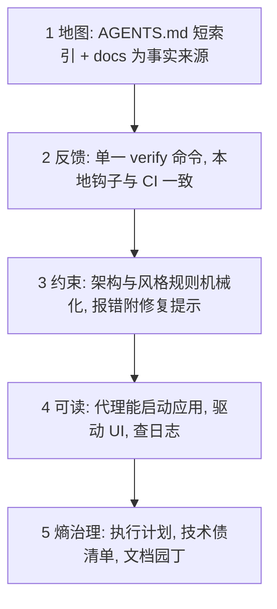

# Harness Engineering 推广

状态：暂停 | 最后更新：2026-11-14 | 涉及仓库：explore-ai、explore-iam、explore-chat、explore-commerce、explore-portfolio、explore-lowcode、explore-ml、explore-three、元仓库

## 目标

参考 [OpenAI: Harness engineering](https://openai.com/index/harness-engineering/) 与 [Martin Fowler 站点：Harness Engineering](https://martinfowler.com/articles/exploring-gen-ai/harness-engineering.html)。核心是：人不直接写代码，而是设计让代理稳定产出的环境。拆成五层：

## 现状

- **explore-ai（最成熟）**：有 ArchUnit 测试、spotless/checkstyle、husky（lint-staged + typecheck）、全量 CI、Playwright e2e、黄金评测。差距：`CLAUDE.md` 约 940 行，是百科而不是地图；没有 `AGENTS.md`；没有单一 `verify` 入口；ArchUnit 报错没有修复提示。
- **explore-iam**：有架构测试、checkstyle、CI。差距：前端只有 build/typecheck，没有 lint 和 test；`docs/Guideline.md` 约 620 行，没有索引；没有钩子、规则和技能。
- **explore-chat**：有架构测试、checkstyle、Spectral OpenAPI 契约检查、turbo。差距：没有 `AGENTS.md`、规则、技能和 husky；Java 与 TS 的 CI 分开，本地没有统一入口。
- **explore-commerce**：有架构规则、技能、husky（typecheck + test）、CI。差距：monorepo 没有包边界检查；CI 不跑 lint；没有 `AGENTS.md`。
- **explore-portfolio**：husky 全量（types + test + lint）、CI + coverage、Bazel。差距：规则只在全局配置里，仓库内不可见；Java 侧没有架构测试；没有 `AGENTS.md`。
- **explore-lowcode**：有规则、代理、技能、eslint、vitest。差距：没有 CI，没有 husky，没有 `AGENTS.md`。
- **explore-ml**：有 pytest、CI、`Guideline.md`（约 650 行）。差距：没有 ruff/mypy，没有代理资产，没有 `AGENTS.md`。
- **explore-three（最薄）**：CI 只有 typecheck + build。差距：没有测试、lint 和任何代理资产。

**跨项目问题**

- 规则集中在个人全局配置里，云端代理、Codex 或 Claude Code 在仓库内看不到，必须落回仓库。
- 6 个仓库各复制了一份 12 个 `.cursor/agents/*.md`，已经出现漂移（Lowcode 多一个 `domain-expert`，少了 `market-analyst`），需要单一来源。

## 方案

### 第 0 步：共享模板（元仓库）

在 `.cursor/skills/developers/public-docs/references/` 下新增 `harness.md`：

- `AGENTS.md` 模板：约 100 行，只写索引和硬约束，详细内容链接到 `docs/`；
- `verify` 约定；
- 报错文案规范：每条规则都写出"违反了什么、为什么、怎么改"；
- 熵治理目录结构。

各仓库只引用这个模板，不复制。

### 第 1 层：地图 + 统一反馈（所有 8 个仓库）

- 新增 `AGENTS.md`：项目一句话说明、目录地图、启动和验证命令、本仓库相关的架构硬约束、指向 Glossary、C4 和 Guideline 的链接。
- explore-ai 的 `CLAUDE.md` 改为指向 `AGENTS.md` 的短文件。
- 每个仓库提供 `pnpm verify` 或 `make verify`，一条命令跑完 lint、types、单测和架构测试；husky 和 CI 都调用它，保证本地和 CI 结果一致。
- 补齐缺口：Lowcode 补 CI 与 husky；IAM 前端补 lint 与 test；Commerce CI 加 lint；ML 加 ruff；Three 加 eslint 与最小 vitest。

### 第 2 层：规则机械化

- Java（ai、iam、chat、portfolio）：统一一套 ArchUnit 规则，覆盖依赖方向（controller 到 service 到 domain，infra 实现 domain）、禁止 `domain/port` 与 `*Port` 后缀、mapper 里不放业务逻辑。每条规则用 `because(...)` 写明修复方式；portfolio 先补齐这套规则。
- TS monorepo（commerce、portfolio、chat）：用 dependency-cruiser 或 eslint boundaries 约束 `apps`、`packages` 的依赖方向。
- Python（ml，以及 portfolio 的 Python 服务）：用 import-linter 约束分层和子服务之间的导入。

### 第 3 层：代理可读

- 每个仓库提供 `scripts/dev-up`，一键启动依赖和应用，并输出健康检查地址。
- 前端统一配 Playwright smoke，让代理能自己验证 UI。
- 后端日志输出结构化 JSON 到本地文件，代理可以直接 grep；日志里不能有 PII。

### 第 4 层：熵治理

- `docs/developer/exec-plans/`：代理执行计划和进度文件。
- `docs/developer/tech-debt.md`：技术债清单。
- `docs/developer/quality.md`：各模块质量评分。
- 定期跑"文档园丁"任务（Cursor Automation 或 CI cron），检查 `AGENTS.md` 和 docs 里的链接与命令是否仍然有效。

## 推进顺序

1. 试点 explore-ai：基础最好，用来验证模板，再把模板固化到元仓库。
2. 复制到 iam、chat：同样是 Spring + Angular 栈，ArchUnit 规则可以直接复用。
3. commerce、portfolio：重点在 TS 包边界。
4. lowcode、ml、three：先补第 1 层的缺口。

交付：每个仓库一条 `<slug>` 分支；有依赖的工作用 `gh stack` 拆成细粒度 Draft PR；`AGENTS.md` 和 docs 的修改先于代码修改。

## 经验记录

第一轮试做覆盖了 ai、iam、chat 三个仓库和元仓库，之后整体撤回。以下是重做时值得直接沿用的经验。

**ArchUnit**

- 所有规则测试共享一次 `ProductionClasses` 导入；每个测试类各自导入会在全量测试时堆内存溢出。
- 存量违规用 `FreezingArchRule` 冻结，`archunit.properties` 里设 `freeze.store.default.path=src/test/resources/archunit_store` 和 `allowStoreCreation=false`。冻结清单只允许减少，并在 `AGENTS.md` 里写明。
- 主干上新增的违规需要重新冻结时，临时加 `freeze.refreeze=true` 跑一次，再去掉。
- 规则的 `should` 为空会直接失败；"DTO 只在 controller 包里"这类规则，用包名加 `(Request|Response)` 类名匹配更稳。

**Checkstyle**

- 警告当错误的仓库（如 chat），要注意 import 顺序、方法名里的缩写和行长。
- 规则辅助类不需要公开时设为包内可见，免得被要求补 Javadoc。

**gh stack**

- 本地 main 落后于远端时，先 `git branch -f main origin/main`，再 `gh stack rebase`。
- `gh stack submit --auto` 没有 `--draft` 参数，但生成的就是 Draft PR。
- 关闭整条 stack 时从顶往下关；被 worktree 检出的分支不会被 `--delete-branch` 删掉，要先移除 worktree。

**本地环境**

- 有系统代理时，本地服务之间的调用要设 `NO_PROXY=localhost,127.0.0.1`，否则请求会绕到代理上返回 502。
- 长时间运行的服务要用真正的后台终端启动，用 nohup 启动的子进程会随调用它的工具一起退出。
- IAM 的 `bootRun` 需要先导出 `.env`，包括 TOTP 加密配置。
- 在同一个 shell 里切换仓库时会串环境变量（如 `SERVER_PORT`），启动前先 unset。

**其他**

- 文档链接检查用 `git ls-files` 列文件，跳过 URL 和锚点，避免被悬空的符号链接卡住。
- 移动端覆盖率达不到门槛时，先把门槛设为当前值作为下限，再在技术债清单里记一行，不要直接关掉。

**参考实现（已关闭，远端分支已删除）**

- explore-ai：[#684](https://github.com/felixzhu97/explore-ai/pull/684)、[#685](https://github.com/felixzhu97/explore-ai/pull/685)、[#686](https://github.com/felixzhu97/explore-ai/pull/686)
- explore-iam：[#141](https://github.com/felixzhu97/explore-iam/pull/141) 到 [#145](https://github.com/felixzhu97/explore-iam/pull/145)
- explore-chat：[#176](https://github.com/felixzhu97/explore-chat/pull/176) 到 [#179](https://github.com/felixzhu97/explore-chat/pull/179)
- 元仓库：[#141](https://github.com/felixzhu97/explore/pull/141)、[#142](https://github.com/felixzhu97/explore/pull/142)
