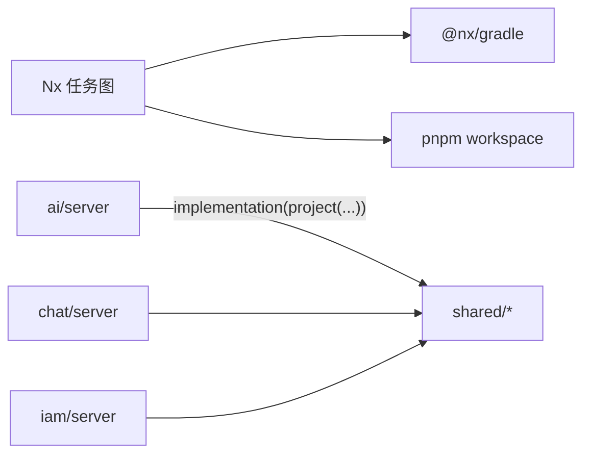

# Explore monorepo：一键启动与跨项目依赖

状态：阶段 0–2 已完成 | 最后更新：2026-11-14 | 涉及仓库：全部 8 个项目 + 元仓库

## 目标

- 一条命令启动一个或几个产品，它们依赖的服务和基础设施自动拉起。
- 重复的模块抽成公共代码，各产品通过构建工具自带的工作区依赖引用，不再复制。
- explore-ai 继续部署在 Render 和 Vercel，只调整构建路径。

## 现状

**启动方式各不相同，没有统一入口**

- explore-ai：`bootRun` 加 `ng serve`。
- explore-iam：要先导出 `.env`，再 `bootRun`。
- explore-chat：`scripts/app/start.sh`。
- explore-portfolio：docker compose 加 uvicorn 加 Bazel。
- explore-commerce：MongoDB 容器加 nodemon。
- explore-ml：uv 加 uvicorn。

**跨项目运行时依赖**

- ai 和 chat 都依赖 iam（OIDC/JWKS，:9100）。
- iam 向 ai 推送 SCIM。
- chat 调用 ml（:8000）和 ai（`/api/agents`，需要服务密钥）。
- ai 调用 ml 做语音。
- 多个项目依赖 Ollama（:11434）。

**端口冲突**

- :4200 被 5 个项目共用。
- portfolio 的 MinIO 占了 9000/9001，和 ai、chat 冲突。
- Kafka 9092 被两个项目各起一份。
- :3001 和 :5433 也有冲突。

**重复模块**

- DDD 基类：ai 和 portfolio 完全一致，iam 和 chat 已经分叉。
- ArchUnit 规则：ai、iam、chat 三份。
- 令牌校验配置：ai 和 chat 两份，差异约 19 行。
- 异常处理和 SCIM 异常处理：ai、iam、portfolio。
- checkstyle、CI action、iOS CI、`.cursor/agents`：多份拷贝。
- SSE、i18n、UI kit 目前只有 ai 在用，暂不抽取。

**explore-ai 部署**

- 后端在 Render，Docker 镜像，`-PcloudMinimal` 打 jar。
- 前端在 Vercel，`/api` 等路径反代到 Render。
- 两边都靠各自的 git 集成自动部署。
- 附带发现：`render.yaml` 没有设置 IAM issuer 相关变量，生产环境会回落到 `localhost:9100`。

## 方案

### 目标结构

产品放在根目录，一个产品一个目录；公共代码只放在 `shared/`。不套 `apps/`、`libs/`、`java/`、`ts/` 这样的技术分层目录。

```text
explore-workspace/
├── ai/          server  web  ios
├── iam/         server  console  ios
├── chat/        server  web  admin  mobile  ios
├── ml/          server  web
├── portfolio/   server  analytics  admin  portal  mobile
├── commerce/    server  web  admin  mobile  ...
├── lowcode/     web
├── three/       web
├── shared/      kernel  identity  provisioning  errors  architecture
├── infrastructure/  ollama  kafka  postgres  ...   # 每个服务一个 compose.yaml
├── tools/       plugin  dev.mjs  # 本地 Nx 插件和 pnpm dev
├── build-logic/                 # Gradle 约定插件
├── compose.yaml                 # include 各 infrastructure/<服务>/compose.yaml
├── eslint.config.js  tsconfig.base.json
└── nx.json  pnpm-workspace.yaml  settings.gradle.kts
```

- 产品下的子目录统一用这几个角色名：`server`、`web`、`admin`、`console`、`portal`、`mobile`、`ios`。commerce 的 `api` 和 ml 的 `ui` 迁入时分别改名为 `server` 和 `web`。
- 前端的 lint 和 TypeScript 配置放在根目录的 `eslint.config.js` 和 `tsconfig.base.json`，各项目继承，不单独建库。
- Gradle 项目路径用扁平的 `:<产品>-<角色>`（例如 `:iam-server`），在 `settings.gradle.kts` 里用 `projectDir` 指到 `iam/server`。这样和 Nx 项目名一致，也不会多出一个空的 `:iam` 父项目。

### 跨项目依赖：用工具自带能力



- **编译期依赖**
  - Java：`implementation(project(":shared-kernel"))`。
  - 前端：pnpm workspace，加根目录配置继承。
  - Python：只有 ml 和 portfolio analytics 两个互不依赖的服务，暂不建 uv workspace。
  - Nx 通过 `@nx/gradle` 和 `package.json` 自动推断依赖图。
- **`shared/` 里的五个库**，每个名字都是它负责的业务概念：
  - `kernel`：实体、值对象、ID 的基类，即 DDD 的 Shared Kernel。
  - `identity`：校验 explore-iam 签发的访问令牌，做成 Spring Boot 自动配置；配置项直接用 Spring Security 标准的 `spring.security.oauth2.resourceserver.jwt.issuer-uri`。
  - `provisioning`：SCIM 用户开通的公共部分，供 ai 和 iam 共用。
  - `errors`：统一的错误响应和异常映射。
  - `architecture`：分层规则，以 Gradle test fixtures 方式提供，带上 `because(... Fix: ...)` 报错文案。
- checkstyle 和 spotless 收进 `build-logic` 约定插件。
- **YAGNI**：只有一个使用方的模块（SSE、i18n、UI kit）先留在 ai 里，出现第二个使用方时再抽。

### 用好工具自带能力

原则：工具已经提供的能力直接用，不再手写脚本或手工维护。每一项写明用它替代什么。

- **Nx**
  - 插件推断目标：`@nx/gradle`、`@nx/angular`、`@nx/next`、`@nx/vite`、`@nx/expo` 自动生成 `build`、`test`、`serve` 等目标，替代逐个手写 `project.json`；只在需要覆盖时写配置。
  - 模块边界：`@nx/enforce-module-boundaries` 加标签 `scope:<产品>`、`type:shared`，规定产品之间不能互相引用、只能引用 `shared/`，替代人工 review 约束。
  - 本地生成器：`nx g @explore/plugin:product <名字>` 按角色目录、项目名和标签生成新产品骨架，替代复制粘贴。
  - 升级：`nx migrate` 自动改写配置和代码，替代手工升级 Nx 及插件。
  - 缓存输入输出：在 `nx.json` 里用 `namedInputs`（如 `production` 排除测试文件）和 `outputs` 定义缓存键，替代"改了什么都全量重跑"。
  - 依赖图：`nx graph` 查看产品和 `shared/` 的依赖，替代手画图核对。
- **Nx Cloud（启用）**
  - Nx Replay 远程缓存：CI 和本地共享构建结果，替代每台机器各自重建。
  - Nx Agents 分布式执行，配合 Atomizer 把 e2e 按文件拆分并行；失败任务自动重试识别不稳定测试。
  - 接入：`nx.json` 里提交 `nxCloudId`，成员本机执行一次 `npx nx login` 就能读缓存；CI 用访问令牌，令牌优先于 ID。`start-ci-run` 等到 3.6 引入 Nx Agents 时再加，没有 agents 时它基本没有作用。
  - ID 本身不是密钥，但工作区的 Default access level 默认是 `read-write`，提交前必须改成 `none`，Logged in users 设为 `read-only`。否则公开仓库里的 ID 谁都能用来写缓存。
  - **安全约束**（启用前必须满足）：
    - 上传内容是任务产物和终端日志，不含源码；设置 `NX_CLOUD_ENCRYPTION_KEY` 做端到端加密，密钥只放在 CI 机密和本机钥匙串。
    - 构建产物不能含密钥：迁入 ai 时（阶段 3）检查 `scripts/inject-datadog-env.mjs` 注入的值，把相关环境变量和 `.env*` 列为任务输入，避免带密钥的产物被缓存命中复用。
    - 令牌分级：只有推送到 main 的 CI 用读写令牌 `NX_CLOUD_ACCESS_TOKEN_RW`，PR 用只读令牌 `NX_CLOUD_ACCESS_TOKEN_RO`，本地登录用户只读，防止缓存投毒；CI 只由 `pull_request` 触发，不用 `pull_request_target`。PR 也用读写令牌的话，任何能开 PR 的人都能写缓存。
    - 终端日志里不输出密钥和个人数据。
    - 先用免费的 Hobby 计划。
    - 退出路径：删掉 `nx.json` 的 `nxCloudId` 和 CI 里的令牌变量，即回到纯本地缓存。
    - 启用前由 privacy-engineer 和 security-engineer 审查（已完成）。
- **Gradle**
  - 版本目录 `gradle/libs.versions.toml`：所有 Java 依赖版本集中一处，替代各项目各写版本号。
  - 工具链解析：foojay 插件按需下载 JDK，替代要求每人手装同一版本 Java。
  - `gradle.properties` 打开 `org.gradle.caching=true` 和 `org.gradle.configuration-cache=true`，替代每次全量配置和编译。
  - JVM Test Suite 插件声明 `integrationTest`，替代自定义 sourceSet 和任务。
  - 依赖校验 `gradle/verification-metadata.xml`：校验依赖的哈希，防止依赖被篡改。
- **pnpm 和 Node**
  - `catalog:`：在 `pnpm-workspace.yaml` 里集中定义前端依赖版本，替代各 `package.json` 各写版本。
  - 根 `package.json` 写 `packageManager`，由 Corepack 锁定 pnpm 版本；根目录一个 `.nvmrc` 锁定 Node 版本，替代各项目各写一份。
- **Compose**
  - `healthcheck` 加 `depends_on: condition: service_healthy`：基础设施之间的就绪顺序交给 Compose，替代 `wait-on` 轮询基础设施。
  - `include:`：根 `compose.yaml` 引入各产品自己的 `compose.yaml`（例如 `chat/compose.yaml` 里放 Kafka），替代把所有服务堆在一个文件。
  - `profiles`：按产品分组，只起需要的服务。
- **Spring Boot**
  - `spring-boot-docker-compose`：`bootRun` 时自动起 compose 服务并通过 `ServiceConnection` 注入连接信息，替代手写数据库地址。
  - Testcontainers 的 `@ServiceConnection`：集成测试自动接入容器，替代手写 `@DynamicPropertySource`。
- **Render 和 Vercel**
  - Render `previews`：每个 PR 自动建预览环境，替代手工建临时服务。
  - Vercel 原生"跳过未受影响的项目"：根据 workspace 依赖判断是否构建；`nx-ignore` 作为后备。
- **GitHub Actions**
  - `gradle/actions/setup-gradle`：自带 Gradle 缓存，替代手写 `actions/cache`。
  - `nrwl/nx-set-shas`：自动算出 `nx affected` 的比较基准，替代手写 base/head。

### 一键启动

- **启动方式**
  - 每个服务一个 Nx `serve` 目标，标记 `continuous: true`。
  - 运行时依赖写进 `dependsOn`，例如 `ai-server:serve` 依赖 `ollama:serve`。
  - `ollama`、`kafka`、`postgres` 等基础设施本身也是 Nx 项目，项目根是 `infrastructure/<服务名>/`。本地插件 `tools/plugin/compose.js` 从 `compose.yaml` 推断 `serve` 目标：端口上已有服务在跑（例如本机原生的 Ollama，可以用 GPU）就直接复用，否则执行 `docker compose up <服务名>`。
  - 基础设施之间的就绪顺序由 Compose 的 `healthcheck` 和 `depends_on: condition: service_healthy` 保证。
  - 应用服务之间同时启动，不互相等待；后端就绪前开发代理暂时报错，刷新即可。
- **命令**：一个命令，参数就是产品名。
  - `pnpm dev ai`：启动 ai 和它依赖的服务。
  - `pnpm dev ai iam`：同时启动 ai 和 iam，相同的依赖只起一份。
  - `pnpm dev kafka`：只起某个基础设施。
  - 由 `tools/dev.mjs` 实现：产品名转成 `tag:scope:<产品>`，其他名字按项目名处理，再执行 `nx run-many -t serve -p ...`。
- **共享基础设施**：根目录的 `compose.yaml` 是 Compose 规范的默认文件名，只负责 `include:`。每个服务一个文件 `infrastructure/<服务名>/compose.yaml`，服务直接用产品名：`ollama`、`kafka`、`postgres`（一个实例上建多个数据库）、`redis`、`mongodb`、`minio`。每种只起一份。
  - 每个基础设施都有真实目录，因为 Nx 的任务哈希要求项目根在磁盘上存在。
  - 只有一个产品用的服务放在产品自己的 `compose.yaml`（例如 `chat/compose.yaml` 里的 Kafka），根文件用 `include:` 引入。
  - 每个服务都写 `healthcheck`；按产品设 `profiles`，只起需要的服务。
- **环境变量**：每个服务的 `.env` 放在自己目录下，例如 `ai/server/.env`，并且被 gitignore。不提交任何密钥。

**端口表**

| 产品 | 端口 |
|------|------|
| ai | server 9000，web 4200 |
| iam | server 9100，console 4201 |
| chat | server 9001，Socket.IO 9002，web 4000，admin 4001 |
| ml | server 8000，web 4210 |
| portfolio | server 8801，analytics 8800，admin 4220，portal 3101 |
| minio | 9400，9401（原 9000/9001） |

### explore-ai 部署（保持 Render 和 Vercel）

- **Render**
  - 根目录的 `render.yaml` 定义 ai 和 iam 两个服务。
  - ai 服务用 `dockerContext: .`，`dockerfilePath: ai/server/Dockerfile`。
  - `buildFilter.paths` 只包含 `ai/server/**`、`shared/**`、`build-logic/**` 和 Gradle 文件。
  - Dockerfile 改为执行 `./gradlew :ai-server:bootJar -PcloudMinimal`，以仓库根目录为构建上下文，旁边放 `Dockerfile.dockerignore`（做法同已完成的 `iam/Dockerfile`）。
  - 打开 `previews`，每个 PR 自动建预览环境。
- **Vercel**
  - Root Directory 设为 `ai/web`，`vercel.json` 跟着移过去。
  - 先用 Vercel 原生的"跳过未受影响的项目"；它对 Gradle 后端的改动判断不准时，再在 Ignored Build Step 用 `npx nx-ignore ai-web` 作为后备。
- **顺手修复**：在 `render.yaml` 里补上 IAM issuer 相关变量；如果暂时不接 IAM，就显式关闭令牌校验。
- **CI**：合并成一个 workflow，执行 `nx affected -t lint test build`；用 `nrwl/nx-set-shas` 算比较基准，`gradle/actions/setup-gradle` 做 Gradle 缓存，Nx Cloud 做远程缓存和分布式执行；iOS 工作流加路径过滤。

### 命名规范

- **名词即业务含义**
  - 目录和库名用它负责的业务概念：`identity`、`provisioning`、`errors`、`kernel`。
  - 不用技术实现名，例如 `oauth2-resource-server`、`scim-service-provider`。
  - 不用泛化词，例如 `common`、`utils`、`support`、`base`。
- **简洁**
  - 一层产品目录，一层角色目录。
  - 公共代码只有 `shared/` 一处。
  - 能用工具默认文件的就不另建目录：`compose.yaml`、`tsconfig.base.json`、`eslint.config.js`。
- **用标准词，不用中式英语**
  - `kernel` 来自 DDD 的 Shared Kernel。
  - `identity`、`provisioning` 是 SCIM（System for Cross-domain Identity Management，RFC 7643/7644）和 IAM 领域的标准用语。
  - `build-logic` 是 Gradle 文档里约定插件目录的标准名。
  - `serve`、`build`、`test`、`lint` 是 Nx 默认的目标名。
- **项目名用 `<产品>-<角色>`**：例如 `ai-server`、`ai-web`、`iam-console`，与目录一一对应。
- **沿用项目自己的叫法**：portfolio 的 Python 服务在它的 README 里叫 "Portfolio Analytics"，所以用 `analytics`。

### 风险与待定

- **已定**：新仓库叫 `felixzhu97/explore-workspace`（元仓已经叫 `felixzhu97/explore`），公开，与现有各项目仓库一致。
- portfolio 从 Bazel 改 Gradle、升级 Spring Boot 4，工作量最大，放在第二批。
- Nx Cloud 是第三方服务：构建产物和日志会上传到它的服务器，受免费计划额度约束。按"用好工具自带能力"里的安全约束接入；退出时删掉 `nxCloudId` 和 CI 里的令牌即可回到本地缓存，不影响其他步骤。
- 安全审查的后续项：GitHub Actions 固定到 commit SHA；补 Nx Cloud 的数据处理协议和保留期说明；去掉 iam `application.yml` 里默认的 localhost issuer。
- Render 和 Vercel 换仓库期间会短暂中断部署，要选在没有发布的时候切换。
- 元仓的 C2 图需要补上 ai 调用 ml 这条边；chat 调用 ai 已经在代码里，应从 planned 改为 active。

## 推进顺序

### 原则

- **一步一个 PR**：每一步都能单独合并、单独回滚；一步里只做一件事，搬迁、改结构和改代码分开做。
- **先搬再改**：产品先原样迁入，在新仓库里能跑，再调整目录结构，最后接入公共代码。
- **一次只动一个产品**：上一个产品的最后一步完成后，再开始下一个。
- **旧仓库兜底**：部署切换完成之前，旧仓库照常可用；切换后保留一段时间再归档。
- **每步有完成条件**：没达到就不进入下一步。

### 阶段 0：准备（只改原仓库，不建新仓库）

| 步骤 | 内容 | 完成条件 |
|------|------|----------|
| 0.1 | 定新仓库的名字和可见性 | 两项都有结论 |
| 0.2 | 在 explore-ai 原仓库补上 `render.yaml` 的 IAM issuer 配置，或显式关闭令牌校验 | 生产环境健康检查通过，不再回落到 `localhost:9100` |
| 0.3 | 在各原仓库改默认端口，按端口表消除冲突 | 第一批的 iam、ai、chat、ml 可以同时在本机启动，端口不冲突 |
| 0.4 | 处理各仓库未合并的 PR | 待迁入仓库没有打开的 PR |

### 阶段 1：骨架（新仓库里还没有产品）

| 步骤 | 内容 | 完成条件 |
|------|------|----------|
| 1.1 | 建仓库，加根 `package.json`（含 `packageManager`）、`.nvmrc`、`pnpm-workspace.yaml`（含 `catalog:`）、`nx.json`、`.gitignore`、README、LICENSE，以及只跑 `nx affected` 的 CI（用 `nrwl/nx-set-shas`） | CI 通过，`pnpm install` 能执行，Corepack 用的是锁定的 pnpm 版本 |
| 1.2 | 加 Gradle wrapper、`settings.gradle.kts`（含 foojay 工具链解析）、`gradle/libs.versions.toml`、`gradle.properties`（打开构建缓存和配置缓存）、`build-logic`（Java 工具链、checkstyle、spotless），暂不包含任何项目；CI 用 `gradle/actions/setup-gradle` | `./gradlew help` 通过，第二次运行复用配置缓存 |
| 1.3 | 加 `compose.yaml`，先只放 `ollama`，带 `healthcheck` 和 `profiles`，并建对应的 Nx 项目 | `pnpm dev ollama` 能起来，`docker compose ps` 显示 healthy |
| 1.4 | 加 `pnpm dev` 脚本 `tools/dev.mjs`：参数转成 `nx run-many -t serve -p ...` | 用 `ollama` 验证通过 |
| 1.5 | 在 `nx.json` 注册插件（`@nx/gradle` 等），定义 `namedInputs`；打开 `@nx/enforce-module-boundaries`，约定 `scope:<产品>`、`type:shared` 标签 | `nx show projects` 能列出推断的目标；违反边界的引用 lint 报错 |
| 1.6 | 加本地生成器 `nx g @explore/plugin:product`，生成角色目录、项目名和标签 | 用它生成一个示例产品，lint 和 build 通过后删除 |
| 1.7 | 接入 Nx Cloud：提交 `nxCloudId`，Default access level 设为 `none`，设置 `NX_CLOUD_ENCRYPTION_KEY`，main 推送用读写令牌、PR 用只读令牌、本地 `nx login` 只读；启用前完成隐私和安全审查 | CI 第二次运行命中远程缓存（已验证：重跑 main 的 CI，30/30 命中）；本地能复用 CI 的缓存（已验证：`nx login` 后 26/30 命中，其余 4 个因本机多出控制台构建产物而不同）；未登录时读写都被拒绝（已验证） |

### 阶段 2：迁入 iam（被依赖最多，自身不依赖其他产品）

| 步骤 | 内容 | 完成条件 |
|------|------|----------|
| 2.1 | `git filter-repo --to-subdirectory-filter iam` 后合并进新仓库，内部结构不变，仍用它自己的 Gradle 构建 | `cd iam && ./gradlew bootRun` 能启动，`git log iam/` 能看到历史 |
| 2.2 | 用 `git mv` 把后端、控制台和 iOS 拆成 `iam/server`、`iam/console`、`iam/ios`，只改路径 | 原有测试全部通过 |
| 2.3 | 把 `iam/server` 加进根 `settings.gradle.kts`，套用 `build-logic`，删掉它自己的 checkstyle 配置；`iam/Dockerfile` 改以仓库根目录为构建上下文 | 在根目录执行 `./gradlew :iam-server:check` 通过；`docker build -f iam/Dockerfile .` 通过 |
| 2.4 | 控制台加进 pnpm workspace；让插件推断 `iam-server`、`iam-console` 的目标，只补写 `serve` 的依赖和标签 | `pnpm dev iam` 能启动两者 |
| 2.5 | 根 CI 覆盖 iam，iOS 和镜像构建各一个带路径过滤的 workflow；原仓库 README 标注"已迁移"，停止在原仓库提交新改动 | iam 相关改动在新仓库的 CI 通过 |

iam 的部署暂不切换，仍从原仓库发布。

阶段 0–2 的 PR：

- 原仓库：[explore#148](https://github.com/felixzhu97/explore/pull/148)、[explore-ai#688](https://github.com/felixzhu97/explore-ai/pull/688)、[explore-ml#109](https://github.com/felixzhu97/explore-ml/pull/109)、[explore-iam#147](https://github.com/felixzhu97/explore-iam/pull/147)
- explore-workspace：[#1](https://github.com/felixzhu97/explore-workspace/pull/1) 到 [#13](https://github.com/felixzhu97/explore-workspace/pull/13)，#9 用 merge commit 合并以保留 iam 的历史

### 阶段 3：迁入 ai

| 步骤 | 内容 | 完成条件 |
|------|------|----------|
| 3.1 | 原样迁入 `ai/`，`.nxignore` 先把它排除在 Nx 依赖图外 | `cd ai && ./gradlew bootRun` 和 `pnpm install && pnpm start` 能启动（pnpm 认最近的 `ai/pnpm-workspace.yaml`，不受根 workspace 影响） |
| 3.2 | 拆成 `ai/server`、`ai/web`、`ai/ios`，只改路径；`docs/`、`.cursor/` 留在 `ai/` | 原有测试和 e2e 通过 |
| 3.3 | 接入根 Gradle 和 `build-logic`，Dockerfile 改以仓库根目录为构建上下文 | `./gradlew :ai-server:check` 通过 |
| 3.4 | `ai/web` 加入 pnpm workspace；`ai-server:serve` 依赖 `ollama:serve`；`ai-web:build` 把 `DD_APPLICATION_ID`、`DD_CLIENT_TOKEN` 列为缓存输入；ai 的 `zod` override 只作用于 `@a2ui/*` | `pnpm dev ai` 和 `pnpm dev ai iam` 都能完整启动，用 IAM 登录成功 |
| 3.5 | 根 CI 覆盖 ai，iOS 和镜像构建各一个带路径过滤的 workflow；删掉 `.husky`；原仓库 README 标注"已迁移" | CI 通过 |
| 3.6 | CI 加 `npx nx start-ci-run`，ai 的 e2e 用 Nx Agents 加 Atomizer 分布式执行，打开不稳定任务自动重试。3.1–3.5 合并后先量 CI 耗时再决定是否做 | CI 总耗时下降，结果与不分布式时一致 |

阶段 3 不用的两项及原因：

- `spring-boot-docker-compose`：`ollama:serve` 已经负责复用本机的 Ollama 或启动 compose 服务；Spring Boot 再起一次 compose 会在本机已有 Ollama 时端口冲突，而 `base-url` 本来就是 `localhost:11434`。
- `wait-on`：后端没起来时，开发代理只是暂时报错，刷新即可；iam 的控制台也没有等待，两边保持一致。

### 阶段 4：切换 explore-ai 部署（每步都可以退回旧服务）

| 步骤 | 内容 | 完成条件 | 回滚 |
|------|------|----------|------|
| 4.1 | 在 Render 用新仓库建一个并行服务：`dockerfilePath: ai/server/Dockerfile`，加 `buildFilter`，打开 `previews` | 新服务健康检查通过；PR 自动生成预览环境；旧服务不变 | 删除新服务 |
| 4.2 | 在 Vercel 用新仓库建一个项目，Root Directory 为 `ai/web`，打开原生的"跳过未受影响的项目"（判断不准再加 `nx-ignore`），反代指向新的 Render 服务 | preview 部署可以登录和聊天；只改 `iam/` 的提交不触发构建 | 删除新项目 |
| 4.3 | 把正式域名切到新的 Vercel 项目 | 正式域名可用 | 域名切回旧项目 |
| 4.4 | 旧的 Render 服务和 Vercel 项目暂停，保留一周 | 一周内没有回滚 | 恢复旧服务 |
| 4.5 | 归档 explore-ai 原仓库，README 指向新仓库 | 已归档 | 取消归档 |

### 阶段 5：抽取 `shared/`（一个库一个 PR，先接一个使用方）

| 步骤 | 内容 | 完成条件 |
|------|------|----------|
| 5.1 | `shared/architecture`：只用于测试，风险最低。先接 ai，再接 iam | 两边架构测试通过，冻结的违规清单不增加 |
| 5.2 | `shared/kernel`：先接 ai，它和 portfolio 的版本完全一致 | ai 测试通过 |
| 5.3 | iam 改用 `shared/kernel`；它的版本已经分叉，先补测试锁定现有行为，再替换 | iam 测试通过，数据库表结构不变 |
| 5.4 | `shared/errors`：先接 ai，再接 iam | 错误响应的 JSON 结构不变（用测试对比） |
| 5.5 | `shared/identity`：先接 ai | 用 IAM 签发的令牌访问 ai 通过 |
| 5.6 | `shared/provisioning`：ai 和 iam 一起改，配一个 SCIM 契约测试 | iam 推送用户到 ai 端到端通过 |

### 阶段 6：迁入 ml 和 chat

| 步骤 | 内容 | 完成条件 |
|------|------|----------|
| 6.1 | 原样迁入 `ml/` | uvicorn 能启动 |
| 6.2 | 改名为 `ml/server`、`ml/web`；`ml-web` 让插件推断目标，`ml-server:serve` 包装 uvicorn | `pnpm dev ml` 能启动 |
| 6.3 | 把 ai 的语音配置指向 `ml-server`，`ai-server:serve` 增加对 ml 的可选依赖 | ai 的语音功能在本地可用 |
| 6.4 | 原样迁入 `chat/` | 原有 `pnpm dev` 在 `chat/` 目录下能启动 |
| 6.5 | 拆成 `chat/server`、`web`、`admin`、`mobile`、`ios`，只改路径 | 原有测试通过 |
| 6.6 | 用 Nx 取代 chat 自带的 Turbo 和启动脚本；接入根 Gradle | `pnpm dev chat` 能启动 |
| 6.7 | Kafka 放进 `chat/compose.yaml`（带 `healthcheck`），由根 `compose.yaml` 用 `include:` 引入；`chat-server:serve` 依赖 `kafka`、`ollama`，可选依赖 iam、ml、ai | `pnpm dev chat ai` 能完整启动，Kafka 只起一份 |
| 6.8 | chat 改用 `shared/identity` | 用 IAM 令牌访问 chat 通过 |

### 阶段 7：迁入 portfolio（工作量最大，拆得最细）

| 步骤 | 内容 | 完成条件 |
|------|------|----------|
| 7.1 | 原样迁入 `portfolio/`，Nx 目标先包装现有 Bazel 命令 | `pnpm dev portfolio` 能启动 |
| 7.2 | 它自己的 compose 服务放进 `portfolio/compose.yaml`，由根文件 `include:`；共用的基础设施改用根文件里的；MinIO 改为 9400/9401 | 和 ai、chat 同时启动不冲突 |
| 7.3 | 拆成 `portfolio/server`、`analytics`、`admin`、`portal`、`mobile`，只改路径 | 原有测试通过 |
| 7.4 | 给 `portfolio/server` 加一个 Gradle 构建，和 Bazel 并存 | 两种构建产出的 jar 都能通过测试 |
| 7.5 | 升级到 Java 25（仍是 Spring Boot 3.4） | 测试通过 |
| 7.6 | 升级到 Spring Boot 4 | 测试通过 |
| 7.7 | 删除 Bazel，改由 `@nx/gradle` 推断目标 | CI 只跑 Gradle，并通过 |
| 7.8 | 改用 `shared/kernel` 和 `shared/errors` | 测试通过 |
| 7.9 | Vercel 项目的 Root Directory 改为 `portfolio/admin` | admin 的 preview 部署可用 |

### 阶段 8：迁入 commerce、lowcode、three（彼此独立，可以按任意顺序）

每个产品三步：

1. 原样迁入，在产品目录下能用原命令启动。
2. 调整成角色目录（commerce 的 `api` 改名为 `server`），让插件推断目标；commerce 的 MongoDB 改用根 `compose.yaml` 里的 `mongodb`。
3. 部署改指新仓库：commerce 的 Vercel Root Directory 和 Lambda 工作流路径，three 的 Vercel Root Directory。lowcode 目前没有部署。

完成条件：`pnpm dev <产品名>` 能启动，部署的 preview 可用。

### 阶段 9：收尾

| 步骤 | 内容 | 完成条件 |
|------|------|----------|
| 9.1 | iam 的部署切到新仓库，做法同阶段 4 | 新服务可用，旧服务保留一周 |
| 9.2 | 元仓的文档同步改为从各产品的 `docs/` 读取，更新 sync-repo 清单 | 同步一次后元仓文档无差异 |
| 9.3 | 更新元仓的 C2 图：补上 ai 调用 ml，chat 调用 ai 改为 active | 图和代码一致 |
| 9.4 | 归档所有已迁移的原仓库 | 原仓库都已归档，README 都指向新仓库 |

## 经验记录

阶段 0–2：

- Nx 的任务哈希要求项目根在磁盘上存在，用插件虚拟出来的基础设施项目会让哈希失败，所以改成 `infrastructure/<服务>/` 真实目录。
- `@nx/gradle` 需要在根 `build.gradle.kts` 和 `build-logic` 里应用 Gradle 插件 `dev.nx.gradle.project-graph`，否则报 `nxProjectGraph not found`。
- Gradle 的嵌套路径 `:iam:server` 会隐式生成空的 `:iam` 项目，Nx 会把它当成一个项目；而且各产品的 Gradle 项目名都会叫 `server`，只能靠 `project.json` 区分。扁平路径加 `projectDir` 两个问题都没有。
- 改 `nx.json` 会让所有任务的哈希变化，之前的远程缓存全部失效，要等 main 的 CI 重新写入一次。
- 打开配置缓存后，构建脚本里的任务不能引用脚本对象（例如在 `onlyIf` 里调用脚本里定义的函数）；要改用 `layout.projectDirectory` 这类可序列化的值。
- pnpm 11 默认禁止依赖的构建脚本，要在 `allowBuilds` 里放行 `nx` 等包；刚发布不到一天的版本会被 `minimumReleaseAge` 拦下，固定到上一个版本，不加排除项。
- 本机 Docker 里下载 Gradle 依赖很慢，完整镜像构建交给 CI 的 `iam image` workflow 验证。

## References

命名依据：

- [Eric Evans, Domain-Driven Design Reference](https://www.domainlanguage.com/ddd/reference/)（Shared Kernel）
- [RFC 7643 SCIM Core Schema](https://www.rfc-editor.org/rfc/rfc7643)、[RFC 7644 SCIM Protocol](https://www.rfc-editor.org/rfc/rfc7644)
- [RFC 6749 OAuth 2.0](https://www.rfc-editor.org/rfc/rfc6749)
- [Compose Specification](https://compose-spec.io/)
- [Gradle: Sharing build logic between subprojects](https://docs.gradle.org/current/userguide/sharing_build_logic_between_subprojects.html)
- [Nx: Project configuration](https://nx.dev/reference/project-configuration)

工具与部署：

- [Nx: Defining a task pipeline](https://nx.dev/recipes/running-tasks/defining-task-pipeline)（continuous 任务与 `dependsOn`）
- [Nx Gradle plugin](https://nx.dev/nx-api/gradle)
- [pnpm workspaces](https://pnpm.io/workspaces)
- [Render Blueprint spec](https://render.com/docs/blueprint-spec)、[Render monorepo support](https://render.com/docs/monorepo-support)
- [Vercel monorepos](https://vercel.com/docs/monorepos)
- [git filter-repo](https://github.com/newren/git-filter-repo)

工具自带能力：

- [Nx: Inferred tasks](https://nx.dev/concepts/inferred-tasks)、[Nx: Enforce module boundaries](https://nx.dev/features/enforce-module-boundaries)、[nx migrate](https://nx.dev/nx-api/nx/documents/migrate)
- [Nx Cloud: Remote cache](https://nx.dev/ci/features/remote-cache)、[Distribute task execution](https://nx.dev/ci/features/distribute-task-execution)、[Split e2e tasks](https://nx.dev/ci/features/split-e2e-tasks)、[Flaky tasks](https://nx.dev/ci/features/flaky-tasks)
- [Nx Cloud: End-to-end encryption](https://nx.dev/ci/recipes/security/encryption)、[Access tokens](https://nx.dev/ci/recipes/security/access-tokens)、[Cache security](https://nx.dev/ci/concepts/cache-security)
- [Gradle: Version catalogs](https://docs.gradle.org/current/userguide/version_catalogs.html)、[foojay toolchain resolver](https://github.com/gradle/foojay-toolchains)
- [Gradle: Build cache](https://docs.gradle.org/current/userguide/build_cache.html)、[Configuration cache](https://docs.gradle.org/current/userguide/configuration_cache.html)
- [Gradle: JVM Test Suite plugin](https://docs.gradle.org/current/userguide/jvm_test_suite_plugin.html)、[Dependency verification](https://docs.gradle.org/current/userguide/dependency_verification.html)
- [pnpm catalogs](https://pnpm.io/catalogs)、[Node.js Corepack](https://nodejs.org/api/corepack.html)
- [Compose include](https://docs.docker.com/compose/how-tos/multiple-compose-files/include/)、[Compose profiles](https://docs.docker.com/compose/how-tos/profiles/)、[Compose startup order](https://docs.docker.com/compose/how-tos/startup-order/)（healthcheck）
- [Spring Boot: Development-time services](https://docs.spring.io/spring-boot/reference/features/dev-services.html)（Docker Compose 和 Testcontainers）
- [Render preview environments](https://render.com/docs/preview-environments)
- [Vercel: Skipping unaffected projects](https://vercel.com/docs/monorepos#skipping-unaffected-projects)
- [gradle/actions](https://github.com/gradle/actions)、[nrwl/nx-set-shas](https://github.com/nrwl/nx-set-shas)
