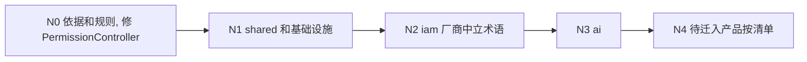

# 命名标准化：按法律法规、国际、国家与行业标准统一术语

状态：草案 | 最后更新：2026-11-14 | 涉及仓库：explore-workspace（shared、基础设施、iam、ai，以及待迁入的 ml、chat、portfolio、commerce、lowcode、three）+ 元仓库

## 目标

- 代码、接口、配置、部署和文档里的命名、规则和校验都能在法律法规、国际标准、国家标准、行业标准或技术规范里找到依据，不用中式直译和自造词。
- 依据始终是现行版本：标准换版、撤销或被替代时，引用和代码随之更新。
- 同一概念全仓库只用一个词；Glossary、领域模型、代码和接口契约用词一致。
- 凡是依据标准的命名、格式或行为，在定义处标注标准编号、章节和官方链接，读代码的人不用猜出处。
- 待迁入的产品用同一份检查表和各自的待改清单，迁入时就改好。

## 现状

- [monorepo 迁移计划](monorepo-migration.md)的"命名规范"一节只约束目录和项目名，没有覆盖类名、接口、令牌 claim、环境变量和部署名。
- iam 沿用了某一家云厂商的词汇（`AllowPolicy`、`PolicyStatement`、`RoleBinding`、ARN 风格的 `ResourceName`），和 XACML、RBAC 等中立标准的用语不一致；短期凭证、模拟身份是自定义接口，没有采用 RFC 8693 Token Exchange。
- ai 有自定义的 `X-` 请求头（`X-Client-Id`、`X-Quota-*`、`X-Admin-Key`、`X-Service-Key`），REST 路径里带动词（`/images/generate`、`/vision/detect`），还有自造词（`Enableable`、`OwnerKey`、`AccountMeResponse`）。
- shared 的 problem `type` 是相对路径前缀，Nx 标签只有 `type:shared` 一个维度，Gradle 插件 id 不统一。
- `PermissionController` 的路由变量是 `{permissionPoint}`，方法参数却叫 `permission`，`GET /api/v1/permissions/{id}` 运行时会报错。
- 待迁入的产品各有问题：
  - **金额和标识没有标准格式**：commerce 的 `price`、chat 的 `AdCampaign.budget` 没有币种；portfolio 的 `CurrencyCode` 不按 ISO 4217 校验，交易所是自由文本，没有 MIC 和 ISIN；commerce 的电话和地址没有 E.164 和国家代码。
  - **REST 风格不一**：ml 和 chat 的一部分已经按 Google AIP 写成 `:verb` 自定义方法，chat、commerce 和 portfolio 的 Python 服务又有动词路径。
  - **个人信息和凭证进了公开环境变量**：portfolio 的 `EXPO_PUBLIC_DEMO_EMAIL`/`EXPO_PUBLIC_DEMO_PASSWORD`，commerce 的 `NEXT_PUBLIC_DD_RUM_USER_EMAIL`。
  - **引用了已被替代的标准**：chat 文档仍引用 RFC 8829，它已被 RFC 9429 取代。
- 代码里只有个别地方标注了依据（如 ai 的 `ClientIdentityFilter` 用 `@see` 链到 OWASP，chat 和 ml 的文档引用了 RFC 和 AIP），大部分依据标准的实现没有出处。

## 方案

### 1. 依据的优先级

按法定权威性和严谨性从高到低，与 [docs/References.md](../References.md) 的章节顺序一致。同一事项的依据有冲突时，按这个顺序取舍：

1. **法律法规**：《个人信息保护法》，GDPR（面向欧盟用户时）。
2. **国际标准**：ISO、IEC、ISO/IEC JTC 1、ITU-T（如 ISO 4217、ISO 3166-1、ISO/IEC 2382、ISO/IEC 22989、ITU-T E.164）。
3. **中国国家标准**：强制性 GB 在前，推荐性 GB/T 在后（如 GB/T 35273、GB/T 25069、GB/T 5271、GB/T 41867）。
4. **中国行业标准**：如金融行业的 JR/T 0171、JR/T 0197。
5. **境外国家标准**：ANSI INCITS（如 INCITS 359 RBAC），NIST SP 和 NIST AI 系列。
6. **国际标准化组织的技术规范**：IETF RFC 和 BCP、W3C Recommendation、IEEE/The Open Group、OASIS、OpenID、Khronos、WHATWG。
7. **行业组织与联盟规范**：PCI DSS、GS1、FIX、OpenAPI、AsyncAPI、CloudEvents、Google AIP、A2A、MCP、ONNX 等。
8. **厂商与框架文档**：Spring、Nx、Gradle、Compose、Kafka。只作参照，不照搬某一家云厂商的产品词汇（iam 采用厂商中立术语）。
9. **维基百科条目标题**：以上都没有时才用。

Glossary 的中文列以国家标准为准：信息安全术语查 GB/T 25069，信息技术术语查 GB/T 5271，AI 术语查 GB/T 41867。

所有链接统一收在 [docs/References.md](../References.md)。下面的清单只写标准编号，链接到那里查。

### 2. 规则（补充迁移计划里的命名规范）

- **一个概念一个词**：全仓库同一概念只用一个名词和一个动词对。例如账号启停沿用 SCIM 的 `active` 属性，动词用 activate/deactivate，不再混用 enable/disable、lock/unlock。
- **不用的词**：
  - 中式直译、自造词（如 `Enableable`）；
  - 实现细节后缀（`Entity`、`Body`）；
  - 泛化词（`common`、`utils`、`base`）；
  - 不通用的缩写（`rec`、`vec`、`lon`）；
  - 第三方品牌名（如 `whatschat`、`instagram-*`）。
- **英文拼写**：统一用美式拼写（`summarization`，不是 `summarisation`），与 IETF、W3C 和所用框架一致。
- **REST 遵循 Google AIP**：
  - 资源导向（AIP-121）；
  - 集合名用复数 lowerCamelCase，路径变量用资源的单数名、多词用 snake_case，例如 `users/{user}/cartItems/{cart_item}`（AIP-122）；
  - 标准方法 Get、List、Create、Update、Delete（AIP-131 至 135）；
  - 其他动作用自定义方法 `:verb`，例如 `POST /images:generate`（AIP-136）；
  - 流式变体用 `stream` 加动词，与 ml 现有的 `documents:streamQuery` 一致；
  - 分页用 `pageSize`/`pageToken`/`nextPageToken`（AIP-158）；
  - 错误格式仍以 RFC 9457 为准。
- **JSON**：字段统一 lowerCamelCase；协议规定了字段名的除外（OAuth 令牌响应的 `access_token`、JWT claim、SCIM 属性按原规范）。
- **HTTP 头**：不用 `X-` 前缀（RFC 6648）。有标准头的用标准头（`Authorization`、`RateLimit`）。
- **错误**：problem `type` 用绝对 URI（RFC 9457、RFC 3986）。
- **事件**：
  - Kafka topic 用小写点分 `<聚合>.<事件>`，事件用过去式，例如 `post.created`；
  - 事件信封用 CloudEvents，`type` 写成 `com.explore.<产品>.<聚合>.<事件>`；
  - 消息契约写成 AsyncAPI 文件。
- **语言标记**：用 BCP 47，未确定的语言用 `und`，不用 `default`。
- **Nx 标签**：两个维度，`scope:<产品>|shared` 加 `type:app|lib|infrastructure|tool`。
- **Gradle**：约定插件 id 统一为 `explore.<名>-conventions`。
- **环境变量**：
  - Spring 属性按 relaxed binding 的写法；
  - 第三方工具用它自己的标准名（Tesseract 的 `TESSDATA_PREFIX`，Kafka 的 `KAFKA_BOOTSTRAP_SERVERS`）；
  - 产品自有变量统一 `APP_` 前缀；
  - 只用大写字母、数字和下划线（POSIX）；
  - 浏览器和移动端的公开变量（`NEXT_PUBLIC_*`、`EXPO_PUBLIC_*`、`VITE_*`）不放个人信息和凭证。
- **部署**：Render 服务、Vercel 项目和容器镜像统一叫 `explore-<产品>`（需要区分角色时为 `explore-<产品>-<角色>`）。

### 3. 领域字段的校验

下表这些字段，在值对象（或前端的模型类型）的构造处按标准校验，并在定义处标注标准。接口边界用 Bean Validation、Pydantic 或 JSON Schema 再校验一次。

| 字段 | 依据 | 规则 |
|------|------|------|
| 币种 | ISO 4217（GB/T 12406） | 三位大写字母，必须在 ISO 4217 代码表里（Java `java.util.Currency`，JS `Intl.supportedValuesOf('currency')`）；不在表里的（如模拟币、链上资产）不能当币种，单独建模 |
| 金额 | ISO 4217 | 金额和币种成对出现，不单独存数字；按币种的最小单位存整数或十进制字符串，不用浮点 |
| 国家和地区 | ISO 3166-1（GB/T 2659.1） | alpha-2 大写代码 |
| 电话号码 | ITU-T E.164 | 存为 `+` 加国家码，最多 15 位数字；展示格式在前端处理 |
| 日期时间 | RFC 3339、ISO 8601-1 | 接口里带时区偏移，存储用 UTC 时刻 |
| 语言 | BCP 47 | 合法语言标记，未确定用 `und` |
| 坐标 | EPSG:4326（WGS 84）、ISO 6709、RFC 7946 | 纬度 [-90, 90]，经度 [-180, 180]；字段名用 `latitude`、`longitude`；文本表示先纬后经（ISO 6709），GeoJSON 先经后纬（RFC 7946） |
| 证券和机构标识 | ISO 6166、ISO 10383、ISO 17442-1、ISO 10962 | ISIN 12 位含校验位；MIC 4 位；LEI 20 位含校验位；资产类别对应 CFI |
| 商品标识 | GS1 General Specifications | GTIN 为 8、12、13 或 14 位，含校验位 |
| 标识符 | RFC 9562 | UUID，新生成的优先用 UUIDv7 |
| 个人信息 | 《个人信息保护法》、GB/T 35273、JR/T 0171（金融） | 字段在 Glossary 里标注是否为个人信息、是否敏感；金融产品按 JR/T 0171 标 C1/C2/C3；支付卡数据按 PCI DSS 不落库 |

### 4. 版本与时效

- 引用标准的现行版本。[docs/References.md](../References.md) 的每条都写版本和状态。
- 标准被替代或撤销（RFC 出现 obsoleted-by，ISO、GB/T、JR/T 换版或废止）时：先改 References，再在同一个 PR 里改引用它的计划、Glossary 和代码标注。
- 草案（如 IETF ratelimit-headers）定稿后，改链正式编号。
- 每季度人工复核一次 References，记录在 PR 里。
- 自动检查见第 5 节。

### 5. 在代码中标注遵循的标准（所有位置）

凡是命名、格式、校验或行为依据某个标准，就在**定义处**标注标准编号、章节和官方链接。沿用仓库已有的写法（`ClientIdentityFilter` 的 `@see <a href="...">OWASP ...</a>`）。

各语言和文件类型的写法：

| 位置 | 写法 |
|------|------|
| Java（类、记录、枚举、接口、控制器方法；有单独依据的枚举常量和字段） | Javadoc `@see <a href="https://www.rfc-editor.org/rfc/rfc8693#section-4.1">RFC 8693 §4.1</a>` |
| TypeScript / Angular / React（服务、模型、路由常量、拦截器） | JSDoc `@see https://www.rfc-editor.org/rfc/rfc9457#section-3.1.1 RFC 9457 §3.1.1` |
| Python（FastAPI 路由、Pydantic 模型、领域类） | docstring 写 `See: RFC 9457 §3.1.1 <https://...>` |
| Swift（iOS） | `/// - SeeAlso: [RFC 6749 §5.1](https://www.rfc-editor.org/rfc/rfc6749#section-5.1)` |
| YAML 和配置（`application*.yml`、`render.yaml`、`compose.yaml`、workflow） | `# RFC 6648: no X- prefix` 加链接 |
| 不支持注释的配置（`project.json`、`package.json`） | 写在相邻的 README 里 |
| Liquibase、Alembic 迁移 | changeset 的 `<comment>` 或迁移文件的 docstring 写依据的标准 |
| SQL 注释、JSON Schema、OpenAPI、AsyncAPI | `description` 写标准编号和链接 |
| `.env.example` | 每个变量上方一行注释写依据（Spring relaxed binding、厂商标准名等） |

要求：

- 标注具体到章节，例如 `RFC 6749 §3.3`，不只写 `RFC 6749`。
- 链接用官方原文，并且必须已收进 [docs/References.md](../References.md)；需要新标准时先在同一个 PR 里补进 References。
- 同一标准有多个版本时（如 ISO/IEC 40500 与 WCAG 2.2），引用权威层级更高的那一条。
- 一处定义只标注一次，使用处不重复。
- 已有的 `@see` 等写法保留，只补章节和缺失的链接。

落实方式：

- 每个改名 PR 同时给所涉及的代码补上标注。
- N1、N2、N3 各阶段末尾再补一个 PR，给本阶段范围内没改名、但同样依据标准的代码补标注（例如 SCIM 资源、TOTP、BCP 47 语言检测）。
- N4 迁入的产品在迁入时补齐。

检查：

- **标准链接检查**：
  - 在 explore-workspace 新增脚本 `tools/check-standard-links.mjs`。它抽取代码和配置里指向下列域名的链接：`rfc-editor.org`、`datatracker.ietf.org`、`openid.net`、`w3.org`、`whatwg.org`、`oasis-open.org`、`khronos.org`、`opengroup.org`、`iso.org`、`itu.int`、`nist.gov`、`ansi.org`、`openstd.samr.gov.cn`、`std.samr.gov.cn`、`npc.gov.cn`、`eur-lex.europa.eu`、`aip.dev`、`gs1.org`、`pcisecuritystandards.org`、`fixtrading.org`、`spec.openapis.org`、`asyncapi.com`、`json-schema.org`、`epsg.org`。
  - 对照 `docs/References.md` 的链接列表，有未收录的就失败。
  - CI 里从元仓库拉取 `docs/References.md` 的原始文件（公开仓库，不需要令牌），作为 `lint` 的一部分运行。
- **每周定时检查**（元仓库，N0 交付）：
  - 用 lychee 检查 References 的所有链接是否可访问；拒绝脚本访问的域名（iso.org、ansi.org、gs1.org）列入排除名单，改由季度人工复核。
  - 读取 `https://www.rfc-editor.org/rfc/rfcNNNN.json` 的 `obsoleted_by` 字段，发现引用了已被替代的 RFC 就报出。
  - 有问题就自动开 issue。
- **禁用词检查**：见第 7 节。
- **代码审查清单**加一项："依据标准的命名、格式、校验和行为在定义处有标注，链接已收进 References"。

### 6. 待改清单

"对外"指改动会影响前端、iOS、其他服务、令牌使用方或部署配置。所有对外契约一次性直接改，不保留旧名（见第 7 节）。标注"待确认"的项，在迁入或对应 PR 的 Glossary 步骤里定。

#### iam（厂商中立术语）

| 现名 | 位置 | 问题 | 标准名 | 依据 | 对外 |
|------|------|------|--------|------|------|
| `AllowPolicy` + `PolicyStatement`，Effect 为 Allow/Deny | `com.iam.policy` | 厂商词汇，"Allow" 和效果重复 | `Policy` + `Rule`，Effect `PERMIT`/`DENY` | XACML 3.0；NIST SP 800-162 | 是（管理接口、控制台） |
| `PolicyBinding`、`RoleBinding` | `com.iam.policy`、`com.iam.identity` | 厂商词汇 | `PolicyAssignment`、`RoleAssignment` | ANSI INCITS 359（user assignment） | 是 |
| `ShortLivedCredential`、`/shortLivedCredentials` | `com.iam.sts` | 自定义的令牌签发接口 | RFC 8693 Token Exchange：`grant_type=urn:ietf:params:oauth:grant-type:token-exchange`，调用方写入 `act` claim，响应 `access_token`/`token_type`/`expires_in`/`issued_token_type` | RFC 8693 §2、§4.1 | 是（令牌使用方） |
| `ImpersonationPolicy` | `com.iam.sts` | 自定义概念 | 基于 RFC 8693 `may_act` 的授权代理人策略；类名待确认 | RFC 8693 §4.4 | 是 |
| `ResourceName`（ARN 风格） | `com.iam.common` 等 | 不是合法的 ARN，也不是标准标识 | URN，例如 `urn:explore:iam:user:<name>` | RFC 8141 | 是（策略内容） |
| 值对象 `Permission` | `com.iam.policy.domain` | 实际表示的是操作 | `Action` | XACML 3.0（action 属性类别） | 否 |
| `permissionPoint`、Permission 聚合、`permissions` claim | `com.iam.policy`、令牌定制 | 自造词；claim 与 `scope` 重复 | OAuth `Scope`；令牌只用 `scope` claim | RFC 6749 §3.3；RFC 9068 §2.2.3 | 是（令牌、ai 的鉴权） |
| `DataAccessLog`、`AdminActivity` | `com.iam.audit` | 两个模型表达同一概念 | `AuditRecord` 加类别（administration、authentication、authorization decision），集合 `auditRecords` | NIST SP 800-92；GB/T 25069"审计记录"；AIP-122 | 是 |
| `FederatedIdentity.provider/externalSubject` | `com.iam.identity` | 和 OIDC 用语不一致 | `issuer`/`subject`；OIDC `name` claim 改放显示名 | OIDC Core §5.1、§5.7 | 是（`name` claim） |
| `machine-client` | iam 配置 | 非标准叫法 | confidential client | RFC 6749 §2.1 | 是（客户端配置） |
| `backupCodes` | iam server、console | 非标准叫法 | recovery codes（look-up secrets） | NIST SP 800-63B（look-up secrets） | 是 |
| `encrypt-password` | iam 配置 | 动词作属性名 | `encryption-password` | Spring Boot relaxed binding | 是（环境变量） |
| `SigningKeyEntity` | `com.iam.sts` | 实现细节后缀 | `SigningKey` | DDD Reference（Entity 不进名字） | 否 |
| STS 的 `iss` | 令牌签发 | 不是签发者 URL | 签发者 URL，与发现文档的 `issuer` 一致 | RFC 7519 §4.1.1；RFC 8414 §2 | 是 |
| `PermissionController` 的 `{permissionPoint}` 与 `@PathVariable permission` | `com.iam.policy.controller` | 名字不一致，运行时报错 | 先修成一致，N2 再随 `Scope` 改名 | — | 否（修缺陷） |

#### ai

| 现名 | 位置 | 问题 | 标准名 | 依据 | 对外 |
|------|------|------|--------|------|------|
| `ClientIdentity`、Cookie `ea_cid`、`X-Client-Id` | ai server、web、iOS | 和 OAuth client 冲突；`X-` 前缀 | 匿名标识 `AnonymousId`；Cookie 和头名待确认，不用 `X-` | RFC 6749 §2（client 已有含义）；RFC 6648 | 是 |
| `OwnerKey`、`owner_key` | ai server 领域和表结构 | 自造词 | `OwnerId`、`owner_id` | DDD Reference（标识用 Id） | 是（数据库） |
| `X-Quota-*` | ai server | 自定义限流头 | `RateLimit`、`RateLimit-Policy` | IETF httpapi ratelimit-headers 草案 | 是 |
| `X-Admin-Key`、`X-Service-Key` | ai server、调用方 | 自定义密钥头 | `Authorization: Bearer` | RFC 6750 §2.1 | 是 |
| `/images/generate`、`/rag/documents/upload`、`/vision/detect`、`/invoke/sse` | ai server、web | 路径里有动词，不符合 AIP | `POST /images:generate`、`POST /rag/documents`（标准 Create）、`POST /vision:detect`、`:streamInvoke` | AIP-133、AIP-136 | 是 |
| 请求、回复和 SSE 字段 | ai server、web、iOS | 同一概念多种叫法 | 请求 `message`，回复 `content`；SSE `token` 改为 `delta`；`brief`/`topic` 改为 `instructions`/`title` | — （统一用词规则） | 是 |
| `PipelineTemplate`（用户保存的） | ai server、web | 和内置模板混淆 | `SavedPipeline` | — （统一用词规则） | 是 |
| `Enableable` | ai server | 自造词 | `Toggleable` | — （不用自造词） | 否 |
| `Official...` | ai server | 直译 | `BuiltIn...` | — （不用直译） | 视接口而定 |
| `AccountMeResponse` | ai server、web | 直译 | `CurrentAccountResponse` | — （不用直译） | 否 |
| `A2aTaskStatus`、`A2aSkill` | ai server | 与 A2A 规范用语不一致 | `A2aTaskState`、`AgentSkill` | A2A Specification | 是（A2A 接口） |
| `DetectedLanguage("default")` | ai server | 不是合法语言标记 | `und` | BCP 47 | 是 |
| 状态枚举的多种成功/失败写法 | ai server | 同一概念多种叫法 | 统一 `SUCCEEDED`/`FAILED` | — （统一用词规则） | 是 |
| `domain/repository` 下不是仓储的接口 | ai server | 名不副实 | 移到 `domain/gateway` | Fowler, Repository | 否 |

#### shared 与基础设施

| 现名 | 位置 | 问题 | 标准名 | 依据 | 对外 |
|------|------|------|--------|------|------|
| `AbstractImmutable` | `shared/kernel` | 名字没说明它是实体 | `AbstractImmutableEntity` | DDD Reference（Entity） | 否 |
| `Problems.TYPE_PREFIX`（相对路径） | `shared/errors`、ai web | problem `type` 应为绝对 URI | 绝对 URI | RFC 9457 §3.1.1；RFC 3986 | 是（错误响应） |
| `requireScopeWhenPresent` | `shared/identity` | 没说清条件 | `requireScopeForBearerTokens` | RFC 6750 | 否 |
| Nx 标签 `type:shared` | shared 各库、`eslint.config.js` | 只有一个维度 | `scope:shared` + `type:lib`；应用项目补 `type:app` | Nx: tag in multiple dimensions | 否 |
| `explore.java-format` | `build-logic` | 不符合约定插件命名 | `explore.java-format-conventions` | Gradle: sharing build logic | 否 |
| workflow 显示名大小写不一 | `.github/workflows` | 风格不一 | 统一大小写 | — | 否 |
| `iam/render.yaml`、`iam/Dockerfile` | iam 根目录 | 部署配置分散 | 并入根 `render.yaml`；`Dockerfile` 移到 `iam/server/` | Render Blueprint spec | 是（部署） |
| IAM issuer 的三个变量名；同一 OAuth 客户端两边叫法不同 | ai、iam 配置 | 同一概念多个名字 | 合成一个变量；客户端两边同名 | Spring Boot relaxed binding；RFC 8414 `issuer` | 是（环境变量） |
| `TESSDATA_PATH` | ai server | 不是 Tesseract 的标准变量 | `TESSDATA_PREFIX` | Tesseract documentation | 是（环境变量） |
| 重复的 MCP URL 变量 | ai 配置 | 同一概念多个名字 | 合并成一个 | — （统一用词规则） | 是（环境变量） |

#### ml（阶段 6 迁入）

| 现名 | 位置 | 问题 | 标准名 | 依据 | 对外 |
|------|------|------|--------|------|------|
| `explores:rank` | 推荐模块路由 | `explores` 是自造复数 | 集合改为业务名词（如 `recommendations:rank`），名称待确认 | AIP-122、AIP-136 | 是 |
| `/ws/v1/audios:transcribe` | `speech` 模块 | `audio` 不可数，`audios` 不是标准复数 | 集合名待确认（如 `speech:transcribe`）；WebSocket 关闭码按 RFC 6455 | AIP-122；RFC 6455 §7.4 | 是 |
| `/output/voice/{job_id}.wav`、`/output/image/...`、`/output/video/...` | 输出文件路由 | 在 `/api/v1` 之外，集合名用单数 | 移到 `/api/v1` 下，挂在对应任务资源上（如 `imageJobs/{image_job}:download`），名称待确认 | AIP-122、AIP-136 | 是 |
| `imageJobs/{image_job}`、`videoJobs/{video_job}` | 图像、视频模块 | 已符合 AIP-122（集合 lowerCamelCase，变量 snake_case） | 保持不变 | AIP-122 | — |
| Redis 键 `rec:user:vec:`、`rec:post:vec:` | `recommendation/infra/factories.py` | 缩写 | `recommendation:user:embedding:`、`recommendation:post:embedding:` | — （不用缩写） | 否 |
| 模型权重 `.pt` | 训练与推理 | pickle 格式加载有执行任意代码的风险，名称和格式不统一 | 分发和加载统一用 safetensors；需要跨框架时用 ONNX；本地推理用 GGUF | safetensors；ONNX；GGUF | 否 |
| 审核标签 `FEMALE_BREAST_EXPOSED` 等 | 内容审核 | 第三方库 NudeNet 的原始词汇 | 在适配层映射成产品自己的类别，原始标签不出边界 | — （厂商词汇只在适配层） | 是 |
| `KMP_DUPLICATE_LIB_OK` | 环境变量 | Intel OpenMP 的原名，用于绕过库冲突 | 保留原名（第三方标准名）；迁入时评估去掉这个绕过 | — | 否 |
| 目录 `python_ml`、`ui` | 仓库结构 | 技术名，不是角色名 | `ml/server`、`ml/web` | 迁移计划命名规范 | 否 |

#### chat（阶段 6 迁入）

| 现名 | 位置 | 问题 | 标准名 | 依据 | 对外 |
|------|------|------|--------|------|------|
| `login`、`logout`、`register`、`refreshToken`、`forgotPassword`、`changePassword` | 认证控制器 | 动词路径；与 iam 的职责重叠 | 登录、注册、刷新令牌改由 iam 的 OIDC 端点承担；仍需保留的写成自定义方法（如 `users/{user}:changePassword`），是否保留待确认 | OIDC Core；RFC 6749；AIP-136 | 是 |
| `list/posts` | 动态控制器 | 动词路径 | `GET /posts`（标准 List） | AIP-132、AIP-158 | 是 |
| `X-Service-Key`、`X-Client-Id` | `com/chat/ai/service/AiProxyService.java` | 自定义 `X-` 头 | 与 ai 同步改：`Authorization: Bearer`，匿名标识随 ai 的命名 | RFC 6648；RFC 6750 §2.1 | 是 |
| Socket 事件 `call:answer` 与 `call:webrtc-answer` | 信令 | 同一动作两个事件 | 合成一个，用 JSEP 的 offer/answer 术语 | RFC 9429 | 是 |
| Kafka topic `offline-messages` | Kafka 配置 | 与其他 topic 的点分写法不一致 | 小写点分 `<聚合>.<事件>`，名称待确认；事件信封用 CloudEvents | CloudEvents 1.0.2；AsyncAPI 3.0 | 是 |
| `KAFKA_BROKERS` | 环境变量 | 不是 Kafka 的配置名 | `KAFKA_BOOTSTRAP_SERVERS`（Spring 项目用 `SPRING_KAFKA_BOOTSTRAP_SERVERS`） | Apache Kafka Documentation；Spring Boot relaxed binding | 是 |
| `CHAT_IAM_*`、`EXPLORE_AI_*` | 环境变量 | 前缀不统一 | 产品自有变量统一 `APP_`；iam issuer 用 Spring Security 的标准属性 | Spring Boot relaxed binding | 是 |
| `AdCampaign.budget`（`long`） | `ads/domain/model/AdCampaign.java` | 金额没有币种 | `Money`（金额加 ISO 4217 币种） | ISO 4217 | 是 |
| `whatschat`、`instagram-loading-splash.tsx` | web 应用 | 第三方品牌名 | 产品名 `explore-chat`、组件 `LoadingSplash` | — （不用第三方品牌名） | 是（部署域名） |
| `docs/Guideline.md` 引用 RFC 8829 | 文档 | 已被替代 | RFC 9429 | RFC 9429 | 否 |

#### portfolio（阶段 7 迁入）

| 现名 | 位置 | 问题 | 标准名 | 依据 | 对外 |
|------|------|------|--------|------|------|
| `CurrencyCode` 只转大写 | `common/domain/model/CurrencyCode.java` | 不校验是否为合法币种 | 按 ISO 4217 代码表校验（`java.util.Currency`） | ISO 4217；GB/T 12406 | 是 |
| 钱包币种 `SIM_COIN` | `blockchain/service/BlockchainService.java` | 不是 ISO 4217 币种，却放在币种字段 | 链上资产单独建模，不进 `CurrencyCode`；名称待确认 | ISO 4217 | 是 |
| `Instrument.exchange`（自由文本） | `Instrument` | 交易场所没有标准标识 | `mic`（ISO 10383） | ISO 10383 | 是 |
| `Instrument` 没有标准证券标识 | `Instrument` | 只有 `symbol` | 加 `isin`；发行人加 `lei`；`assetClass` 对应 CFI 类别 | ISO 6166；ISO 17442-1；ISO 10962 | 是 |
| 链 ID 配置 | 区块链配置 | 命名不统一 | `chainId` | EIP-155 | 否 |
| 路径变量 `{account_id}`、`{data_id}`、`{watchlist_item_id}`、`{preferenceId}`、`{block_index}` | Java API 路由 | 风格不一 | 用资源单数名：`{account}`、`{watchlist_item}`、`{preference}`、`{block}` | AIP-122 | 是 |
| `/risk-metrics/compute`、`/risk-metrics/compute-batch`、`/forecast/model`、`/analytics/delta-info` | `apps/server-python` | 动词路径；含义不清 | `riskMetrics:compute`、`riskMetrics:batchCompute`；后两项的资源名待确认 | AIP-122、AIP-136 | 是 |
| `HF_SUMMARISATION_MODEL` | 环境变量 | 英式拼写，没有 `APP_` 前缀 | `APP_HF_SUMMARIZATION_MODEL` | — （美式拼写、`APP_` 前缀） | 是 |
| `EXPO_PUBLIC_DEMO_EMAIL`、`EXPO_PUBLIC_DEMO_PASSWORD` | 移动端环境变量 | 凭证和邮箱进了公开变量，会打包进应用 | 删除；示例账号只在服务端配置。**隐私阻断项，迁入前必须处理** | 《个人信息保护法》；GB/T 35273 | 是 |
| 账户、交易、持仓数据 | 各金融模块 | 没有个人金融信息分类 | 按 JR/T 0171 标 C1/C2/C3，按 JR/T 0197 分级 | JR/T 0171；JR/T 0197 | 否 |
| `finpulse-*`、`@fintech/*` 包名，Bazel 构建 | 仓库结构 | 品牌名和泛化名 | 按迁移计划改为 `portfolio-<角色>` 和 `@explore/portfolio-*` | 迁移计划命名规范 | 否 |

#### commerce（阶段 8 迁入）

| 现名 | 位置 | 问题 | 标准名 | 依据 | 对外 |
|------|------|------|--------|------|------|
| `price`、`originalPrice`（Number） | `services/api/src/models/Product.ts`、`Order.ts` | 金额没有币种，用浮点 | 金额加币种（`price` 加 `priceCurrency`），按最小单位存 | ISO 4217；schema.org Offer | 是 |
| 商品没有标准标识 | `Product.ts` | 只有内部 id | 加 `gtin` | GS1 General Specifications | 是 |
| `phone` | `User.ts`、`Order.ts` 的 `shippingAddress` | 没有统一格式 | 存为 E.164 | ITU-T E.164 | 是 |
| 地址没有国家字段 | `User.ts`、`Order.ts` | 无法区分国家 | 加 `country`（ISO 3166-1 alpha-2） | ISO 3166-1；GB/T 2659.1 | 是 |
| `/:id/cancel`、`/import/json`、`/admin/:status`、`/user/:userId`、`/:userId/item/:productId`、`/reset-password` | `services/api/src/routes` | 动词路径、单数集合 | `orders/{order}:cancel`、`products:import`、按状态用 List 的过滤参数、`users/{user}/orders`、`users/{user}/cartItems/{cart_item}`；`/reset-password` 是否改由 iam 承担待确认 | AIP-122、AIP-132、AIP-136 | 是 |
| `X-Service-Key`、`X-Client-Id`（含小写写法） | `services/api/src/routes/ai-agents.ts` | 自定义 `X-` 头 | 与 ai 同步改 | RFC 6648；RFC 6750 §2.1 | 是 |
| `SECRET_KEY` 与 `JWT_SECRET` | 环境变量 | 同一用途两个名字 | 合成一个，`APP_` 前缀 | — （统一用词规则） | 是 |
| `NEXT_PUBLIC_DD_RUM_USER_EMAIL` | web 环境变量 | 邮箱进了公开变量，会发到浏览器 | 删除；监控只用匿名标识。**隐私阻断项，迁入前必须处理** | 《个人信息保护法》；GB/T 35273 | 是 |
| 支付网关集成 | `packages/payment-integration` | 需要明确不保存卡数据 | 只保存支付网关返回的标识，卡号等数据不落库、不进日志 | PCI DSS v4.x | 否 |
| 容器名 `shopping-mongodb` | docker compose | 名称与产品不符 | 改用根 `compose.yaml` 的 `mongodb` | 迁移计划阶段 8 | 否 |
| 目录 `api`，crawler、data-mining、CLI | 仓库结构 | 技术名，角色名未定 | `api` 改为 `server`；其余迁入前定角色名 | 迁移计划命名规范 | 否 |

#### lowcode（阶段 8 迁入）

这份克隆里只有文档，源码迁入时按下表核对，具体名称以源码为准。

| 检查项 | 依据 | 要求 |
|--------|------|------|
| 页面和组件定义 | JSON Schema 2020-12 | 用 JSON Schema 描述并校验，导出的代码随定义一起版本化 |
| 主题变量 | Design Tokens Format Module | 变量名和分组按 Design Tokens 格式 |
| 无障碍 | ISO/IEC 40500（WCAG 2.2）；GB/T 37668；WAI-ARIA 1.2 | 画布生成的组件带正确的 role 和 `aria-*` |
| 文件后缀 `*.manager.ts` 与 `*.service.ts` 混用 | — （一个概念一个词） | 统一成一种 |
| LocalStorage 持久化 | 《个人信息保护法》；GB/T 35273 | 不在浏览器存储里保存个人信息 |

#### three（阶段 8 迁入）

| 现名 | 位置 | 问题 | 标准名 | 依据 | 对外 |
|------|------|------|--------|------|------|
| `ThemeId = 'bright' \| 'tech'` 与路由 `globe-light`、`globe-dark` | `src/theme/theme.service.ts`、`src/globe/globe.routes.ts` | 同一概念两套名字 | 统一为 `light`、`dark`，与 CSS `prefers-color-scheme` 的取值一致 | — （一个概念一个词） | 是（路由） |
| `GeoCoord` 的 `lat`、`lon` | `src/geography/geo-coord.ts` | 缩写；坐标系没写明 | `latitude`、`longitude`，在定义处标注 WGS 84 和取值范围 | EPSG:4326；ISO 6709 | 否 |
| 渲染接口 | 全部 | 依据没写明 | WebGL 2.0；以后迁移时参照 WebGPU | WebGL 2.0；WebGPU | 否 |

#### 文档

- Glossary 去掉代码里已不存在的术语，补齐"别名"列，中文列按 GB/T 25069、GB/T 5271、GB/T 41867 校对；个人信息字段标注是否敏感。
- "hallucination"不再列为禁用词：它是通用术语，NIST AI 600-1 另称 confabulation，两者都可以用。
- 待迁入产品的 Glossary 在迁入 PR 里按本节对应的表更新。

### 7. 交付约束

- **living docs 顺序**：每个 PR 先改 Glossary，再改领域模型（`C4-Code-Domain-Model.puml`），再改代码，最后改其余 C4 和故事地图。
- **对外契约一次性直接改，不保留旧名**。同一个 PR 里同步改：
  - Liquibase 或 Alembic：`renameTable`/`renameColumn` 或等价操作，保留数据；
  - 前端和控制台、iOS、Expo 应用；
  - ai 读取的 iam 令牌 claim；
  - `render.yaml` 和 Render、Vercel 的环境变量；
  - OpenAPI 和 AsyncAPI 契约文件。
- **完成条件**：`:<项目>:check` 通过；相关前端单测通过；本地 `pnpm dev <产品>` 端到端通过；合并后验证生产环境。
- **防止回退**：维护一份禁用词清单，在 CI 里用 `rg` 检查，命中就失败。初始内容：
  - iam、ai：`permissionPoint`、`Enableable`、`OwnerKey`、`X-Client-Id`、`ea_cid`；
  - 各产品通用：`X-Service-Key`、`X-Admin-Key`、`X-Quota-`；
  - chat：`KAFKA_BROKERS`、`whatschat`；
  - portfolio：`SIM_COIN`、`SUMMARISATION`、`EXPO_PUBLIC_DEMO_`；
  - commerce：`DD_RUM_USER_EMAIL`、`shopping-mongodb`。

  每改完一个概念就把旧名加进清单；产品迁入后它的条目才生效。

### 8. 风险

- 已安装的旧版 iOS 和 Expo 应用、外部 BFF 调用会因为头、路径和字段改名失效。改 Header、Cookie 和令牌之前先确认没有外部调用方；移动端需要同步发版。
- 改匿名标识的 Cookie 名会让匿名用户的历史对话失去关联，PR 里要写明影响。
- 改令牌 claim（`scope`、`act`、`name`、`iss`）时 iam 和使用它的产品必须同时部署，否则鉴权失败。
- Liquibase、Alembic 改表名、列名会直接作用于生产库，先在本地用生产结构的副本验证。
- 金额改成"金额加币种"、电话改成 E.164 需要迁移存量数据；无法确定币种或国家码的记录要先列出来人工处理，不能猜。

### 9. 隐私与安全

- 涉及身份、Cookie、令牌、审计记录、个人信息字段的 PR 推送前做隐私和安全审查：
  - N2：STS、audit、federated identity；
  - N3：匿名标识和密钥头；
  - N4：各产品的个人信息字段、支付、公开环境变量。
- 新增个人信息处理时同时做合规审查。
- 审查结论在对话里回报，不写进提交信息或 PR 描述。
- 第 6 节标为"隐私阻断项"的，在对应产品迁入的第一个 PR 里处理，不能推迟。

## 推进顺序

每个概念一个 PR，有依赖的用 stacked PR 交付。

| 阶段 | 内容 | 完成条件 |
|------|------|----------|
| N0 | 本计划和 References 合入元仓库；单独修 `PermissionController` 的路由变量；加 `tools/check-standard-links.mjs`、禁用词检查（先只报告不失败）和元仓库的每周链接与 RFC 状态检查 | 修复有回归测试；三个检查在 CI 里能运行 |
| N1 | shared 和基础设施的待改项，一项一个 PR；阶段末补标注 PR | 所有项目 `check` 通过；部署正常 |
| N2 | iam 厂商中立术语，按 Policy/Rule → Assignment → Scope/Action → Token Exchange → AuditRecord → 其余的顺序；阶段末补标注 PR | iam 和 ai 本地端到端通过；生产登录、令牌、SCIM 正常 |
| N3 | ai 的待改项，先头和 Cookie，再 REST 路径和字段，最后内部类名；阶段末补标注 PR | ai web、iOS 和生产对话正常 |
| N4 | 随迁移计划迁入：阶段 6 按第 6 节 ml、chat 两张表，阶段 7 按 portfolio 表，阶段 8 按 commerce、lowcode、three 表；隐私阻断项在迁入的第一个 PR 处理；标注在迁入时补齐 | 迁入 PR 通过本节对应的清单；禁用词和标准链接检查切换为失败即阻断 |

## 经验记录

- iso.org、webstore.ansi.org、gs1.org 对脚本返回 403，链接只能通过搜索结果核对；全国标准信息公共服务平台的检索页靠脚本渲染，条目页的 `hcno`、`id` 要从搜索结果里取，不能拼。
- ISO/IEC 27000 在 2026-07 换版后不再是术语标准，信息技术术语改以 ISO/IEC 2382 为国际依据，信息安全中文术语以 GB/T 25069 为准。
- 按"现行版本"核对时发现：RFC 8829 已被 RFC 9429 取代；OpenAPI 现行为 3.2.0；POSIX 现行为 IEEE Std 1003.1-2024。用 rfc-editor 的 JSON 元数据（`obsoleted_by`）可以批量查 RFC 状态。
- ml 已有的 `imageJobs/{image_job}` 看起来像大小写混用，其实正是 AIP-122 的写法（集合 lowerCamelCase，路径变量 snake_case），不用改。

## References

标准类链接见 [docs/References.md](../References.md)，章节顺序即本计划第 1 节的优先级。本计划引用的依据：

- **法律法规**：《个人信息保护法》、GDPR。
- **国际标准**：ISO/IEC 2382、ISO/IEC 27000、ISO/IEC 22989、ISO 4217、ISO 3166-1、ISO 8601-1、ISO 6709、ISO 10383、ISO 6166、ISO 17442-1、ISO 10962、ISO/IEC 40500、ITU-T E.164。
- **中国国家标准**：GB/T 35273、GB/T 25069、GB/T 5271.1、GB/T 41867、GB/T 12406、GB/T 2659.1、GB/T 37668。
- **中国行业标准**：JR/T 0171、JR/T 0197。
- **境外国家标准**：ANSI INCITS 359；NIST SP 800-63B、800-162、800-92；NIST AI 600-1。
- **技术规范**：RFC 3339、3986、6455、6648、6749、6750、7519、8141、8414、8693、9068、9110、9429、9457、9562，BCP 47，IETF ratelimit-headers 草案；WCAG 2.2、WAI-ARIA 1.2、WebAuthn、WebGPU；POSIX.1-2024；XACML 3.0；OIDC Core；WebGL 2.0。
- **行业规范**：PCI DSS、GS1 General Specifications、EIP-155、AsyncAPI、JSON Schema、CloudEvents、Google AIP-121、122、132、133、136、158；A2A；ONNX、safetensors、GGUF；EPSG:4326；schema.org；Design Tokens Format Module。
- **框架**：Nx tags、Gradle convention plugins、Spring Boot relaxed binding、Apache Kafka、Tesseract。
