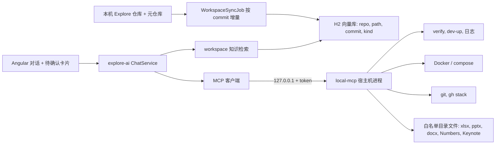

# Workspace 助手：一个入口询问所有系统

状态：草案 | 最后更新：2026-11-14 | 涉及仓库：explore-ai（入口），其余 Explore 项目与元仓库为数据来源

## 目标

在 Explore AI 的对话里：

- 能回答所有 Explore 系统的问题，并给出出处；
- 经用户确认后调度本地资源：各仓库脚本、Docker、Git/gh，以及读写本地工作文件（Numbers、PPT 等）。

## 现状

explore-ai 已有的基础：

- RAG：`rag/infra/etl/PdfAndTextDocumentReader.java`、`ChunkingDocumentTransformer.java`、`rag/infra/vector/H2SpringAiVectorStore.java`；嵌入走本地 Ollama `qwen3-embedding:0.6b`。
- RAG 检索按用户隔离：文档归属于 IAM JWT 或 Client Identity cookie，`documentIds` 为空时检索该用户的全部文档。
- MCP：既是服务端也是客户端（`mcp/infra/client/SpringAiMcpClientGateway.java`、`McpSessionRegistry.java`），`application-prod.yml` 已有 `streamable-http.connections` 配置项。
- 另有 `agent/`、`skill/`、`automation/`（定时）、`eval/`（黄金评测）模块。

## 方案

### 架构

### 知识层（explore-ai 新增 `workspace` 功能模块，按 controller/service/domain/infra/mapper 分层）

- `workspace.yml` 清单：列出各仓库的本地路径与要索引的路径（docs、`AGENTS.md`、C4 `.puml`、Glossary、故事地图、源码），默认包含元仓库作为总索引。
- Reader：Markdown 按标题切分；PlantUML 保留元素名和关系；代码按类和函数切分，覆盖 Java、TS、Python。
- 同步：记录每个仓库最后索引的 commit，用 `git diff` 只重建变更文件；接到 `automation` 定时任务里。
- 回答必须附 `repo:path:line` 出处，找不到依据时明确说不知道。
- 在 `eval/` 加跨项目黄金问题集，例如"Portfolio 下单如何经 IAM 鉴权"，作为回归门槛。

### 调度层（新增 `local-mcp`，放在 explore-ai 仓库内独立目录）

- 用 Python FastMCP 实现，运行在宿主机：Office 读写需要 openpyxl、python-pptx、python-docx，Numbers 和 Keynote 需要 `osascript`；explore-ai 在 Docker 里运行时也碰不到宿主机资源。
- 只监听 127.0.0.1，带访问令牌；只在 `local` profile 下连接，生产环境不启用。
- 工具按风险分两级：
  - 只读，直接执行：仓库列表与 `git status`、日志查询、`docker ps/logs`、白名单目录下的文件列表与读取。Numbers/Keynote 先用 AppleScript 导出为 xlsx/pptx/pdf 再读。
  - 写操作，必须审批：运行 `verify`、`dev-up`；`compose up/down`；写 Office 文件（一律另存为新版本，不覆盖原文件）；Git 操作（建分支、按路径暂存后提交，禁止 `git add -A`；`gh stack` 提交 Draft PR）。
- 不开放任意 shell：所有命令来自各仓库 `AGENTS.md` 中声明的脚本或固定白名单；路径限制在 `workspace.yml` 与文件白名单目录内；所有命令都有超时。

### 审批与审计

- 写操作在对话中显示为待确认卡片：写明要执行的命令、影响的路径和 diff 预览，确认后才执行。
- 审计日志只记工具名、参数摘要、结果状态和耗时，不记文件内容和对话内容。

### 隐私与安全

- 嵌入始终在本地（Ollama）。对话模型默认是云端服务，会把检索到的文档片段、代码和文件内容发出去，因此提供"仅本地模型"开关；涉及本地工作文件时默认使用本地模型。
- 合入前跑 privacy-engineer 与 security-engineer 评审，阻断项必须修完。

### 能做到与做不到

- 能做到：跨系统问答并给出处；"把 commerce 跑起来并告诉我测试为什么挂"；"读这份 Numbers 表，把汇总写进新 PPT"；"在 iam 修这个问题并开 Draft PR"，每个写操作都由用户确认。
- 做不到或不建议：无确认的自动写操作；任意命令执行；覆盖原文件；在用户不知情时把本地文件发给云端模型。

## 推进顺序

1. 各仓库具备 `AGENTS.md`、`verify`、`dev-up`（见 [Harness Engineering 推广](harness-engineering-rollout.md)），这些就是 local-mcp 要调用的命令。
2. 活文档：Glossary 与领域模型先行。
3. 知识层 MVP：先只索引文档，再加代码。
4. local-mcp 只读工具。
5. 审批流。
6. 写工具。
7. 隐私与安全评审贯穿每个 PR。

## 经验记录

### MVP 试做记录（代码已回退，留作重做时的参考）

做法：复用现有 RAG，把各项目文档作为当前用户的 RAG 文档同步进去，不新建向量表。

- 后端（`com.ai.workspace`）：
  - `domain/model/WorkspaceSource`：project、path、content；`fileName` 统一加 `workspace/` 前缀，用来区分用户自己上传的文档。
  - `domain/repository/WorkspaceSourceRepository`：`findProjects()`、`findSources()`。
  - `infra/FileSystemWorkspaceSourceRepository`：读各项目根目录的 `README.md`、`AGENTS.md` 和 `docs/**/*.md|*.puml`；跳过 `node_modules`、`build`、`dist`、`target`、`.git`、png、超过大小上限的文件和非 UTF-8 文件；项目列表为空时自动取根目录下带 `README.md` 的子目录。
  - `service/WorkspaceSyncService`：对比已有文档，新增、更新、删除，返回各项计数和失败的文件。
  - `controller/WorkspaceController`：`GET /api/workspace` 返回项目列表，`POST /api/workspace/sync` 执行同步。
- RAG 出处：`RetrievalAugmentationAdvisor` 配 `ContextualQueryAugmenter.builder().documentFormatter(...)`，每个片段前加 `[<文档标题>]`，并在系统提示里要求注明出处。
- 开关：`app.workspace.enabled` 默认关闭，`application-prod.yml` 里写死关闭；用 `@ConditionalOnProperty` 控制，没有用 `ModuleFlag`，因为它和 LaunchDarkly 绑定。
- 前端：RAG 页面文档栏加"同步工作区文档"按钮，只在 `GET /api/workspace` 成功时显示。

### 已知坑

- 写接口必须带 `X-Requested-With` 请求头，否则会被 CSRF 过滤器拒绝；浏览器里的应用会自动带上，用 curl 调试时要手动加。
- 文档按用户隔离（Client Identity / JWT）：用 curl 同步的文档在浏览器里看不到，要在浏览器里自己点同步。
- 首次同步 12 个项目要逐个文件做嵌入，耗时较长，同步请求会长时间阻塞；应该改成异步任务并显示进度。
- 只比较文件大小来判断是否变化，会漏掉大小不变的内容修改；应该改为按 commit 或内容哈希判断。
- 按用户同步会让每个用户各存一份相同的文档；正式实现应改为共享的 workspace 索引，按 repo 和 commit 记录。
