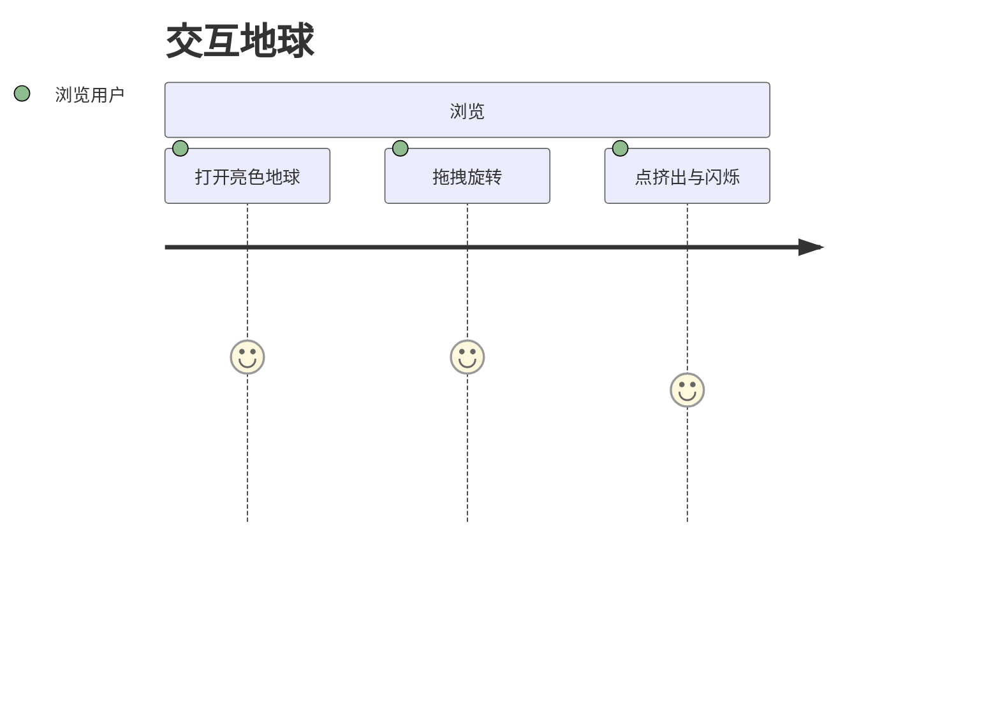
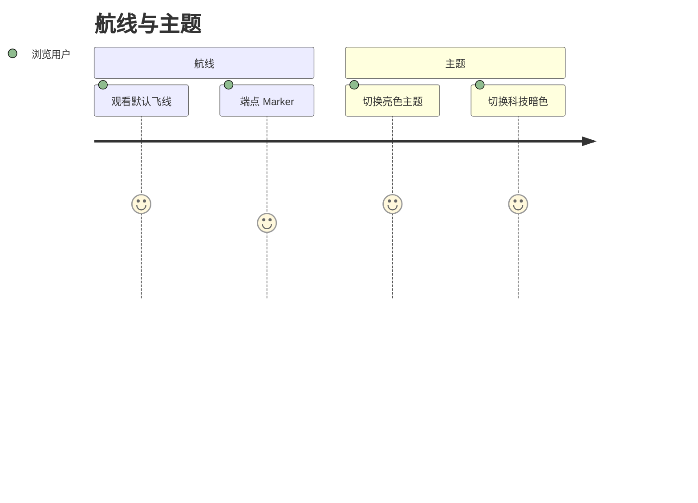

# 用户故事地图

> 格式：Jeff Patton 故事地图 + Mermaid journey + GWT（Epic 分文件）。  
> 故事正文与验收标准见 [user-stories/](./user-stories/)；本页只做索引，避免双源。

## 用户画像

| 角色 | 说明 |
|------|------|
| 浏览用户 | 在浏览器中旋转地球、观看飞线与主题切换 |
| 开发者 | 基于 `src/{geography,route,theme,globe}` 扩展地球仪可视化 |

## 旅程总览

### 交互地球

### 航线与主题

---

## Backbone 故事地图

### 已交付

| 交互地球 | 飞线航线 | 主题切换 |
|----------|----------|----------|
| [US-01](./user-stories/E1-globe-interaction.md#us-01-拖拽旋转地球) 拖拽旋转 | [US-03](./user-stories/E2-flying-routes.md#us-03-默认国际航线飞线) 默认飞线 | [US-05](./user-stories/E3-theme-switch.md#us-05-亮色主题地球) 亮色主题 |
| [US-02](./user-stories/E1-globe-interaction.md#us-02-陆地点挤出与闪烁) 挤出与闪烁 | [US-04](./user-stories/E2-flying-routes.md#us-04-航线端点-marker) 端点 Marker | [US-06](./user-stories/E3-theme-switch.md#us-06-科技暗色主题地球) 科技暗色 |

---

## Epic 索引

| Epic | 文件 | 状态 |
|------|------|------|
| E1 交互地球 | [E1-globe-interaction.md](./user-stories/E1-globe-interaction.md) | 已实现 |
| E2 飞线航线 | [E2-flying-routes.md](./user-stories/E2-flying-routes.md) | 已实现 |
| E3 主题切换 | [E3-theme-switch.md](./user-stories/E3-theme-switch.md) | 已实现 |

## 参考

- [Glossary](../Glossary.md)
- [C4 模型](../developer/c4-model/)
